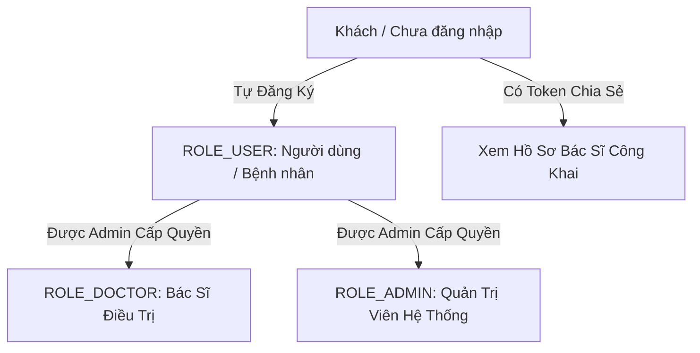

# 📋 TỔNG HỢP DANH SÁCH CHỨC NĂNG HỆ THỐNG
## HỆ THỐNG QUẢN LÝ BỆNH ÁN CÁ NHÂN & SỨC KHỎE GIA ĐÌNH (PHR VIỆT NAM)

> **Tài liệu đặc tả toàn bộ các chức năng, phân hệ nghiệp vụ, sitemap và ma trận phân quyền đã được xây dựng và đang vận hành trực tiếp trên hệ thống.**

---

## 📌 I. THÔNG TIN KIẾN TRÚC & CÔNG NGHỆ VẬN HÀNH

| Thành Phần | Công Nghệ Sử Dụng | Cổng Dịch Vụ / Địa Chỉ | Trạng Thái |
| :--- | :--- | :--- | :---: |
| **Frontend Web** | React 18 (JSX Component-based), Vite 8, Ant Design v5, Recharts, Axios, Dayjs | `http://localhost:5173` | 🟢 Hoạt động |
| **Backend REST API** | Spring Boot 3, Java 21 LTS, Spring Security 6 (JWT + BCrypt), OpenPDF, MapStruct | `http://localhost:8088/api/v1` | 🟢 Hoạt động |
| **Cơ Sở Dữ Liệu** | Microsoft SQL Server (15 tables, 28 Entity 3NF, audit log, soft delete) | `localhost:1433` (`HETHONGQUANLYBENHANCANHAN`) | 🟢 Hoạt động |
| **Tài Liệu API** | Swagger UI / OpenAPI 3.0 | `http://localhost:8088/swagger-ui.html` | 🟢 Hoạt động |

---

## 👥 II. MA TRẬN PHÂN QUYỀN HỆ THỐNG (RBAC MATRIX)

Hệ thống được thiết kế theo mô hình **Kiểm soát truy cập dựa trên vai trò (Role-Based Access Control - RBAC)** với 4 cấp độ:

### 🔒 Nguyên Tắc An Ninh Phân Quyền:
1. **Khóa cứng tự đăng ký**: Mọi người dùng tự đăng ký tài khoản trên web **chỉ nhận duy nhất quyền `ROLE_USER`**.
2. **Cấp quyền tập trung**: Quyền `ROLE_DOCTOR` và `ROLE_ADMIN` tuyệt đối không thể tự đăng ký mà phải do Quản trị viên (Admin) chỉ định và cấp phép tại trang Quản trị người dùng (`/admin/users`).
3. **Bảo vệ chống truy cập trái phép (IDOR)**: Người dùng chỉ được xem/sửa hồ sơ thuộc quyền sở hữu của tài khoản mình; các thao tác đều được kiểm tra JWT token tại Backend.

---

## 📑 III. CHI TIẾT TỪNG PHÂN HỆ CHỨC NĂNG TRÊN WEB

### 1. Phân Hệ Xác Thực & Bảo Mật Tài Khoản (Authentication & Security)
- **Đăng Nhập Hệ Thống (`/login`)**:
  - Xác thực qua Email và Mật khẩu mã hóa BCrypt.
  - Cấp cặp JWT Access Token (hạn 24h) và Refresh Token (hạn 7 ngày).
  - Giao diện đăng nhập chuẩn mực với chức năng ghi nhớ đăng nhập và chuyển hướng phân quyền thông minh.
- **Đăng Ký Tài Khoản (`/register`)**:
  - Thu thập thông tin: Họ tên, Email, Số điện thoại, Ngày sinh, Mật khẩu.
  - Tự động kích hoạt tài khoản và mặc định gán quyền `ROLE_USER`.
- **Quên Mật Khẩu Quy Trình 3 Bước OTP (`/forgot-password`)**:
  - *Bước 1*: Nhập Email đăng ký, hệ thống sinh mã OTP ngẫu nhiên 6 chữ số có hiệu lực trong 15 phút.
  - *Bước 2*: Nhập mã xác thực OTP 6 số để kiểm tra tính hợp lệ.
  - *Bước 3*: Thiết lập mật khẩu mới an toàn, tự động vô hiệu hóa mã OTP sau khi đổi thành công (chống replay attack).
- **Cài Đặt & Đổi Mật Khẩu Chủ Động (`/settings`)**:
  - Xem thông tin hồ sơ tài khoản và các quyền hệ thống đang sở hữu.
  - Form đổi mật khẩu yêu cầu xác thực mật khẩu cũ và khớp mật khẩu mới.

---

### 2. Phân Hệ Bảng Điều Khiển Tổng Quan (Dashboard KPI)
- **Đường dẫn**: `/dashboard`
- **Chức năng chính**:
  - **4 Thẻ Chỉ Số Sức Khỏe Tổng Quan**:
    - Số lượng hồ sơ thành viên trong gia đình.
    - Tổng số đợt khám bệnh án đã lưu trữ.
    - Lịch hẹn tái khám sắp tới (kèm nhãn nhắc nhở).
    - Chỉ số đo huyết áp gần nhất (tự động phân loại theo chuẩn AHA: Tối ưu / Bình thường / Cao).
  - **Khu Vực Tác Vụ Y Tế Nhanh (Quick Actions)**:
    - *Tạo Bệnh Án Mới*
    - *Nhập Số Đo Sức Khỏe*
    - *Thêm Hồ Sơ Người Thân*
    - *Đặt Lịch Hẹn Khám*
    - *Xem Tủ Thuốc Đang Dùng*
  - **Bảng Lịch Sử Bệnh Án Gần Đây**:
    - Hiển thị danh sách các đợt khám mới nhất (Mã bệnh án, Chuyên khoa, Bệnh nhân, Chẩn đoán, Ngày khám).
    - **Nút tải tệp PDF A4 trực tiếp** từ bảng điều khiển chỉ với 1 cú nhấp chuột.

---

### 3. Phân Hệ Hồ Sơ Sức Khỏe Cá Nhân & Gia Đình (Family Health Profiles)
- **Danh Sách Hồ Sơ Gia Đình (`/profiles`)**:
  - Quản lý đa hồ sơ: Bản thân (Chủ tài khoản), Vợ/Chồng, Con cái, Cha mẹ, Người thân.
  - Thẻ tóm tắt nhân khẩu học: Họ tên, Ngày sinh, Giới tính, Nhóm máu (A, B, AB, O, Rh+/Rh-), Số thẻ BHYT, Số CCCD.
  - **Bảo mật PII**: Tự động che số định danh CCCD và BHYT (`001******789`, `DN401******789`).
  - Thêm mới và chỉnh sửa hồ sơ thành viên.
- **Chi Tiết Hồ Sơ Sức Khỏe (`/profiles/:id`)**:
  - Tích hợp 3 Tab chuyên sâu:
    1. **Tiền Sử Dị Ứng (Allergies)**:
       - Quản lý các loại dị nguyên: Thuốc (Penicillin, Aspirin...), Thực phẩm (Hải sản, Đậu phộng...), Thời tiết, Khác.
       - Mức độ phản ứng: Nhẹ, Trung bình, Nặng / Nguy kịch (Sốc phản vệ).
       - **Hiệu ứng trực quan**: Nhãn dị ứng nghiêm trọng có hiệu ứng nhấp nháy đỏ (`allergy-pulse`) cảnh báo bác sĩ.
    2. **Bệnh Nền Mãn Tính (Chronic Diseases)**:
       - Ghi nhận: Tăng huyết áp, Đái tháo đường, Hen suyễn, Tim mạch...
       - Năm chẩn đoán, mã bệnh ICD-10 tương ứng, tình trạng kiểm soát.
    3. **Tiền Sử Bệnh Gia Đình (Family History)**:
       - Theo dõi bệnh lý di truyền qua các thế hệ (Ung thư, Đột quỵ, Đái tháo đường).

---

### 4. Phân Hệ Quản Lý Bệnh Án Điện Tử 4 Chuyên Khoa (Medical Records)
- **Sổ Khám Bệnh & Lọc Bệnh Án (`/records`)**:
  - Bộ lọc đa tiêu chí: Lọc theo thành viên gia đình, theo cơ sở y tế (Bệnh viện), và theo chuyên khoa.
  - Bảng dữ liệu chuẩn hóa hiển thị mã đợt khám (MS: 01, 02, 10...), viện phí, ngày vào/ra viện.
- **Wizard Tạo Bệnh Án Chuẩn Bộ Y Tế (`/records/create`)**:
  - Quy trình 3 bước chuẩn y khoa:
    - *Bước 1 - Thông tin hành chính*: Chọn hồ sơ thành viên, bệnh viện, bác sĩ điều trị, khoa phòng, ngày giờ vào viện, diện bảo hiểm.
    - *Bước 2 - Khám bệnh & Sinh hiệu*: Lý do vào viện, bệnh sử, đo dấu hiệu sinh tồn (Mạch, Huyết áp, Nhịp thở, Thân nhiệt), Chiều cao & Cân nặng (Hệ thống **tự động tính chỉ số BMI** và phân loại thể trạng).
    - *Bước 3 - Phân hệ chuyên khoa tương ứng*:
      - **Nội khoa (MS: 01/BV-01)**: Khám chi tiết 7 hệ cơ quan (Tuần hoàn, Hô hấp, Tiêu hóa, Thận - Tiết niệu, Thần kinh, Cơ xương khớp, Nội tiết).
      - **Ngoại khoa (MS: 10/BV-01)**: Thông tin phẫu thuật/thủ thuật, phương pháp vô cảm (Gây mê/Gây tê), diễn biến hậu phẫu, vết mổ, dẫn lưu.
      - **Nhi khoa (MS: 02/BV-01)**: Đánh giá thể chất nhi, quá trình sinh non/đủ tháng, cân nặng lúc sinh, chỉ số Apgar, lịch sử bú mẹ & tiêm chủng.
      - **Sản khoa**: Ràng buộc kiểm tra nghiêm ngặt (chỉ áp dụng cho hồ sơ Nữ). Áp dụng **quy tắc Naegele** tự động tính:
        $$\text{Ngày Dự Sinh (EDD)} = \text{Kinh Cuối} + 7\text{ ngày} - 3\text{ tháng} + 1\text{ năm}$$
        và tự động tính **Tuổi thai theo tuần** chính xác.
- **Xem Toàn Diện Đợt Điều Trị (`/records/:id`)**:
  - Xem chi tiết từng mục khám, bảng chỉ số sinh tồn.
  - Dòng thời gian chuyển khoa điều trị (Timeline transfer).
  - **Xuất File PDF Bệnh Án Chuẩn A4**: Nút tích hợp gọi trực tiếp thư viện OpenPDF ở Backend để tải tệp PDF chuẩn Quốc hiệu - Tiêu ngữ Bộ Y Tế, đầy đủ bảng sinh hiệu, chẩn đoán, thuốc và chữ ký bác sĩ.

---

### 5. Phân Hệ Đơn Thuốc & Cảnh Báo An Toàn Dược Lý (Prescriptions)
- **Đường dẫn**: `/prescriptions`
- **Chức năng chính**:
  - **Tổng Hợp Thuốc Đang Dùng Tại Nhà (Active Medications)**:
    - Danh mục các loại thuốc bệnh nhân đang uống hằng ngày (Tên thuốc, Hàm lượng, Liều dùng, Cách dùng, Ngày bắt đầu - Ngày kết thúc).
  - **Thuật Toán Cảnh Báo Dị Ứng Thuốc Chéo (Cross-Allergy Safety Check)**:
    - Khi có đơn thuốc mới, hệ thống tự động quét đối chiếu hoạt chất của thuốc với danh sách tiền sử dị ứng của bệnh nhân.
    - **Cảnh báo tức thì**: Cảnh báo sốc phản vệ đối với nhóm kháng sinh Beta-lactam / Penicillin (Amoxicillin, Ampicillin...).
  - **Tra Cứu Danh Mục Thuốc Quốc Gia**:
    - Tra cứu trực tuyến theo tên biệt dược hoặc hoạt chất (Paracetamol, Amlodipine, Metformin, Augmentin...).

---

### 6. Phân Hệ Theo Dõi Chỉ Số Sinh Hiệu Tại Nhà (Health Metrics)
- **Đường dẫn**: `/metrics`
- **Chức năng chính**:
  - **Form Ghi Nhận Số Đo Tại Nhà**:
    - Huyết áp (Tâm thu / Tâm trương), Nhịp tim (lần/phút), Nồng độ Oxy máu (SpO2 %), Đường huyết (mmol/L), Thân nhiệt (°C), Cân nặng (kg).
  - **Phân Loại Tự Động Theo Chuẩn Quốc Tế**:
    - Chuẩn Hiệp hội Tim mạch Hoa Kỳ (**AHA**): Huyết áp tối ưu (<120/<80), Tăng huyết áp độ 1 (130-139), Tăng huyết áp độ 2 (>=140), Cơn tăng huyết áp khẩn cấp (>180).
    - Chuẩn Hiệp hội Đái tháo đường Hoa Kỳ (**ADA**): Đánh giá đường huyết lúc đói và sau ăn.
  - **Biểu Đồ Đường Biến Thiên Trực Quan (Recharts)**:
    - Vẽ đồ thị theo thời gian thực theo dõi xu hướng huyết áp tâm thu và tâm trương, giúp phát hiện sớm các bất thường tim mạch.

---

### 7. Phân Hệ Lịch Hẹn Khám & Tái Khám (Medical Appointments)
- **Đường dẫn**: `/appointments`
- **Chức năng chính**:
  - **Đặt Lịch Khám Mới**:
    - Chọn thành viên khám, Bệnh viện / Phòng khám, Chuyên khoa, Bác sĩ phụ trách, Ngày giờ hẹn, Lý do khám, Ghi chú dặn dò (Nhịn ăn sáng, mang hồ sơ cũ...).
  - **Quản Lý Danh Sách & Lịch Khám Sắp Tới**:
    - Phân loại trạng thái bằng thẻ màu:
      - 🔵 `Đã lên lịch (SCHEDULED)` - Đính kèm cờ báo lịch hẹn sắp tới.
      - 🟢 `Đã khám xong (COMPLETED)`
      - ⚪ `Đã hủy (CANCELLED)`
  - Cập nhật trạng thái một chạm hoặc hủy lịch hẹn có hộp thoại xác nhận.

---

### 8. Phân Hệ Cận Lâm Sàng & Tệp Đính Kèm Y Tế (Clinical Investigations)
- **Đường dẫn**: `/clinical`
- **Chức năng chính**:
  - **Kết Quả Xét Nghiệm (Lab Tests)**:
    - Lưu trữ theo từng đợt khám: Huyết học (CBC), Sinh hóa máu (Glucose, Men gan SGOT/SGPT, Creatinine, Acid Uric...), Tổng phân tích nước tiểu, Miễn dịch.
    - So sánh với khoảng tham chiếu chuẩn.
    - **Cờ cảnh báo bất thường (`isAbnormal`)**: Tự động đánh dấu đỏ các chỉ số vượt ngưỡng an toàn.
  - **Chẩn Đoán Hình Ảnh (Diagnostic Imaging)**:
    - Quản lý các phương pháp chụp chiếu: X-quang kỹ thuật số, Siêu âm màu, Cắt lớp vi tính (CT Scanner), Cộng hưởng từ (MRI), Điện tâm đồ (ECG).
    - Ghi nhận vị trí giải phẫu, mô tả tổn thương hình ảnh và kết luận của bác sĩ CĐHA.
  - **Tệp Đính Kèm Y Tế (Medical Attachments)**:
    - Đính kèm hình ảnh X-quang, phiếu kết quả xét nghiệm PDF hoặc dữ liệu DICOM.
    - Giới hạn dung lượng an toàn tối đa **10MB** theo đúng quy định.
    - Xem trước và mở tài liệu trực tiếp.

---

### 9. Phân Hệ Chia Sẻ Hồ Sơ Bệnh Án An Toàn (Profile Sharing)
- **Quản Lý Liên Kết Chia Sẻ (`/shares`)**:
  - Cho phép người dùng cấp quyền xem hồ sơ bệnh án cho Bác sĩ điều trị bên ngoài mà Bác sĩ **không cần tạo tài khoản hay đăng nhập**.
  - **Sinh mã Token 32 ký tự bảo mật**: Mỗi liên kết sở hữu một chuỗi token ngẫu nhiên không thể đoán trước.
  - Thiết lập quyền hạn (`Chỉ đọc` hoặc `Toàn quyền xem cận lâm sàng`) và thời hạn hiệu lực (mặc định 7 ngày).
  - Thu hồi quyền truy cập tức thì (Revoke) bất cứ lúc nào.
- **Cổng Tra Cứu Công Khai Cho Bác Sĩ (`/share/view/:token`)**:
  - Đường dẫn công khai độc lập, giao diện tối ưu hóa cho chuyên gia y tế.
  - Kiểm tra tính hợp lệ và thời hạn của token.
  - Hiển thị đầy đủ: Thông tin nhân khẩu học (đã che CCCD/BHYT), Cảnh báo dị ứng nổi bật, Bệnh mạn tính, Lịch sử các đợt khám và sinh hiệu.
  - Chân trang hiển thị điều khoản miễn trừ trách nhiệm y khoa.

---

### 10. Phân Hệ Bàn Làm Việc Bác Sĩ (Doctor Workspace)
- **Đường dẫn**: `/doctor/workspace`
- **Phân quyền truy cập**: Dành riêng cho `ROLE_DOCTOR` và `ROLE_ADMIN`.
- **Chức năng chính**:
  - Bàn tiếp nhận và hội chẩn bệnh án theo dõi.
  - Xem tóm tắt đợt khám, lý do vào viện và chẩn đoán sơ bộ.
  - **Nhập Nhận Xét & Tư Vấn Chuyên Môn**:
    - Đánh giá diễn biến lâm sàng thực thể của bệnh nhân.
    - Ghi nhận lời dặn điều trị, chế độ ăn uống sinh hoạt.
    - Lên kế hoạch theo dõi và hẹn ngày tái khám.
  - Xem dòng thời gian lịch sử ghi chú của các bác sĩ tham gia hội chẩn đợt khám.

---

### 11. Phân Hệ Quản Trị Hệ Thống (Admin Control Center)
- **Phân quyền truy cập**: Dành riêng cho Quản trị viên (`ROLE_ADMIN`).
- **Bao gồm 3 phân khu chức năng**:
  1. **Quản Trị Người Dùng & Phân Quyền (`/admin/users`)**:
     - Xem toàn bộ danh sách tài khoản đã đăng ký trên hệ thống.
     - Tìm kiếm nhanh theo Họ tên, Email hoặc Số điện thoại.
     - **Cấp Quyền Bác Sĩ (ROLE_DOCTOR)**: Đi kèm hộp thoại chỉ định trực tiếp Khoa / Chuyên môn công tác (Khoa Tim Mạch, Khoa Nhi, Khoa Chấn Thương Chỉnh Hình, Khoa Mắt, Thần Kinh, Sản Khoa...) và hỗ trợ nút Đổi Khoa điều chuyển công tác linh hoạt.
     - **Cấp Quyền Quản Trị Viên (ROLE_ADMIN)** cho người dùng.
     - **Hạ quyền** về Người Dùng bình thường (ROLE_USER) và tự động thu hồi phân bổ chuyên khoa.
     - Khóa hoặc mở khóa tài khoản vi phạm.
  2. **Quản Trị Danh Mục Y Tế (`/admin/catalogs`)**:
     - *Danh mục mã bệnh quốc tế ICD-10*: Tra cứu từ điển mã bệnh (I10, E11, J00...), thêm mã bệnh mới vào từ điển hệ thống.
     - *Danh mục thuốc quốc gia*: Tra cứu biệt dược, hoạt chất, thêm thuốc mới vào danh mục (Dạng bào chế, hàm lượng, số đăng ký).
  3. **Giám Sát Nhật Ký Kiểm Toán (`/admin/audit-logs`)**:
     - Truy vết 100% các thao tác nhạy cảm trong hệ thống: Đăng nhập, Tạo bệnh án, Cập nhật phân quyền, Khóa tài khoản, Xóa dữ liệu.
     - Ghi nhận đầy đủ: Thời gian thực (Timestamp), Tên tài khoản, Hành động (`action`), Đối tượng tác động (`entityName`, `entityId`), và Địa chỉ IP (`ipAddress`). Tuân thủ tiêu chuẩn an ninh y tế HIPAA.

---

## 🗺️ IV. BẢNG TỔNG HỢP ROUTING / SITEMAP TOÀN BỘ WEB

| STT | Đường Dẫn (Route) | Tên Màn Hình / Chức Năng | Quyền Truy Cập | File JSX Phụ Trách |
| :---: | :--- | :--- | :---: | :--- |
| **1** | `/` | Trang chủ giới thiệu sản phẩm y tế (Landing Page) | Công khai (Public) | `LandingPage.jsx` |
| **2** | `/login` | Đăng nhập tài khoản & Nút demo Admin | Công khai (Public) | `LoginPage.jsx` |
| **3** | `/register` | Đăng ký tài khoản người dùng mới | Công khai (Public) | `RegisterPage.jsx` |
| **4** | `/forgot-password` | Quên mật khẩu quy trình 3 bước OTP | Công khai (Public) | `ForgotPasswordPage.jsx` |
| **5** | `/share/view/:token` | Cổng xem hồ sơ chia sẻ dành cho Bác sĩ ngoài | Công khai (Public Token) | `PublicShareViewPage.jsx` |
| **6** | `/dashboard` | Bảng điều khiển KPI & Lối tắt y tế nhanh | User, Doctor, Admin | `DashboardPage.jsx` |
| **7** | `/profiles` | Quản lý danh sách hồ sơ thành viên gia đình | User, Doctor, Admin | `ProfilesPage.jsx` |
| **8** | `/profiles/:id` | Chi tiết hồ sơ: Tiền sử Dị ứng, Bệnh mạn tính | User, Doctor, Admin | `ProfileDetailPage.jsx` |
| **9** | `/records` | Sổ khám bệnh & Danh sách đợt khám bệnh án | User, Doctor, Admin | `MedicalRecordsPage.jsx` |
| **10** | `/records/create` | Form Wizard tạo bệnh án 4 chuyên khoa (BMI, Naegele) | User, Doctor, Admin | `MedicalRecordCreatePage.jsx` |
| **11** | `/records/:id` | Chi tiết đợt khám & Nút xuất file PDF A4 | User, Doctor, Admin | `MedicalRecordDetailPage.jsx` |
| **12** | `/prescriptions` | Đơn thuốc, Tủ thuốc tại nhà, Cảnh báo dị ứng chéo | User, Doctor, Admin | `PrescriptionsPage.jsx` |
| **13** | `/metrics` | Nhập số đo sinh hiệu & Biểu đồ huyết áp AHA (Recharts) | User, Doctor, Admin | `MetricsPage.jsx` |
| **14** | `/appointments` | Đặt lịch khám, theo dõi lịch hẹn & nhắc tái khám | User, Doctor, Admin | `AppointmentsPage.jsx` |
| **15** | `/clinical` | Cận lâm sàng: Xét nghiệm máu, CĐHA, Tệp đính kèm | User, Doctor, Admin | `ClinicalInvestigationsPage.jsx` |
| **16** | `/shares` | Quản lý liên kết chia sẻ hồ sơ sinh mã token 32 ký tự | User, Doctor, Admin | `SharesPage.jsx` |
| **17** | `/settings` | Thông tin tài khoản, vai trò & Đổi mật khẩu | User, Doctor, Admin | `SettingsPage.jsx` |
| **18** | `/doctor/workspace` | Bàn làm việc Bác sĩ: Đánh giá lâm sàng & Lời dặn | **Doctor, Admin** | `DoctorWorkspacePage.jsx` |
| **19** | `/admin/users` | Quản lý tài khoản người dùng & Cấp quyền tập trung | **Admin** | `AdminUsersPage.jsx` |
| **20** | `/admin/catalogs` | Quản trị danh mục mã bệnh ICD-10 & Thuốc quốc gia | **Admin** | `AdminCatalogsPage.jsx` |
| **21** | `/admin/audit-logs` | Giám sát nhật ký kiểm toán hệ thống (Audit Trail) | **Admin** | `AdminAuditLogsPage.jsx` |
| **22** | `/403` | Trang thông báo từ chối quyền truy cập (Forbidden) | Mọi người | `Error403.jsx` |
| **23** | `/404` | Trang thông báo không tìm thấy đường dẫn (Not Found) | Mọi người | `Error404.jsx` |

---

## 🎯 V. HƯỚNG DẪN THAO TÁC TRẢI NGHIỆM TRÊN WEB

### 1. Trải nghiệm với tư cách Quản trị viên (Admin):
1. Truy cập `http://localhost:5173/login`.
2. Bấm nút **"Đăng Nhập Nhanh (Tài Khoản Quản Trị)"** (hoặc nhập `admin@phr.vn` / `Admin@123`).
3. Truy cập toàn bộ 21 tính năng, đặc biệt là:
   - **Bảng điều khiển**: Bấm tải thử PDF bệnh án A4.
   - **Tạo bệnh án**: Thử chức năng tự động tính BMI và công thức Sản khoa Naegele.
   - **Đơn thuốc**: Kiểm tra phát hiện dị ứng thuốc chéo nhóm Penicillin.
   - **Chỉ số sinh hiệu**: Nhập thử huyết áp để xem biểu đồ Recharts và phân loại AHA.
   - **Quản Trị Người Dùng** (`/admin/users`): Thử cấp quyền Bác Sĩ hoặc Admin cho các tài khoản trong danh sách.

### 2. Trải nghiệm với tư cách Bệnh nhân tự đăng ký:
1. Truy cập `http://localhost:5173/register` và điền thông tin cá nhân.
2. Đăng nhập vào: Tài khoản này **chỉ có quyền `ROLE_USER`**, không thấy các menu Quản trị Admin hay Bàn làm việc Bác sĩ (nếu cố tình gõ link `/admin` sẽ bị chuyển về trang `403 Forbidden`).
3. Dùng tài khoản Admin vào `/admin/users` bấm **"Cấp Bác Sĩ"** cho tài khoản đó, sau đó đăng nhập lại sẽ thấy xuất hiện menu **Bàn Làm Việc Bác Sĩ** (`/doctor/workspace`) ngay lập tức!
