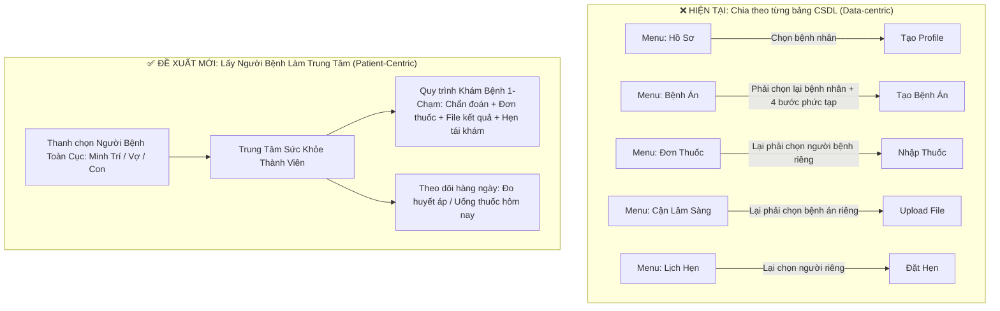
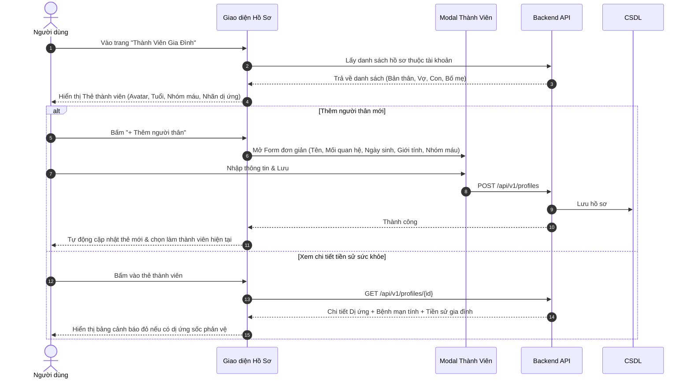
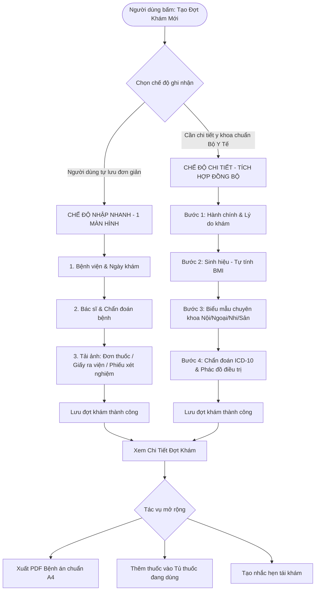
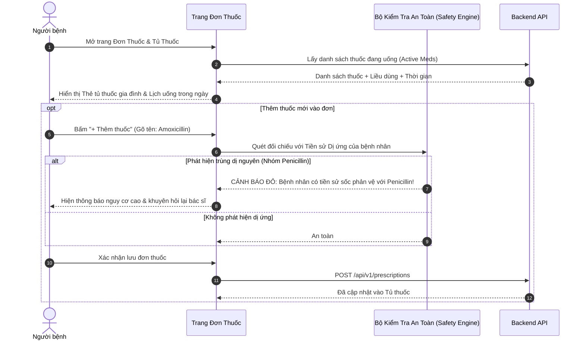
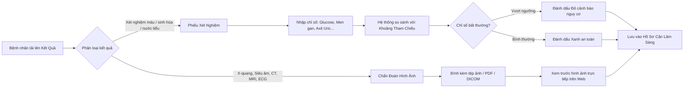
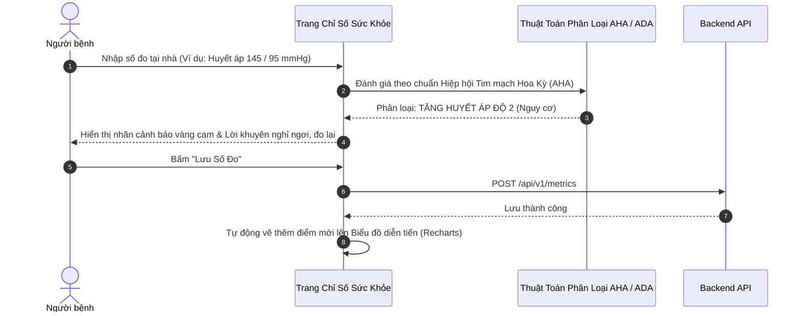
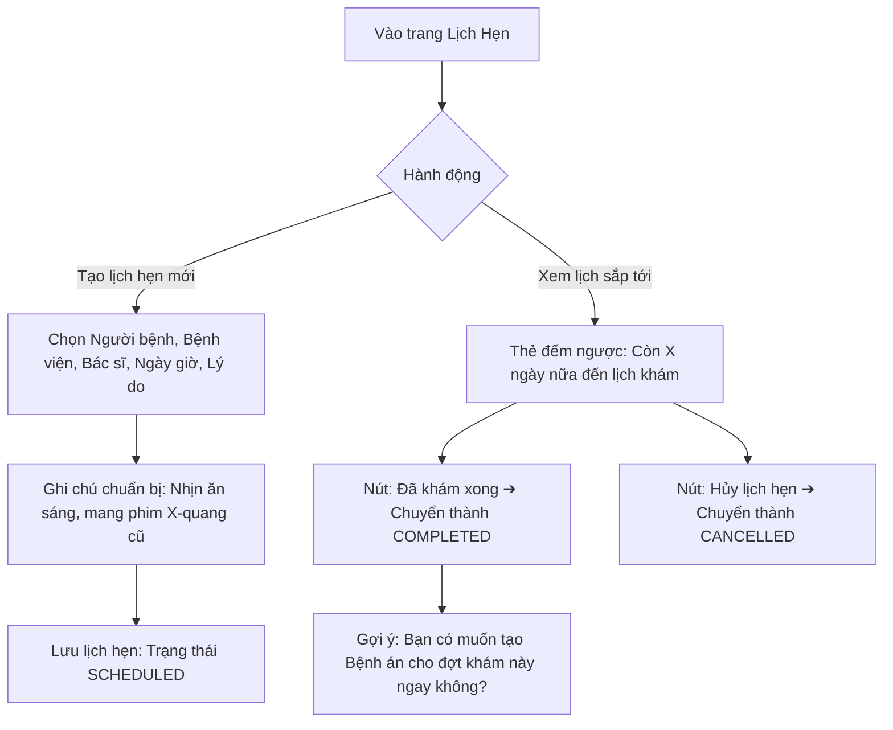
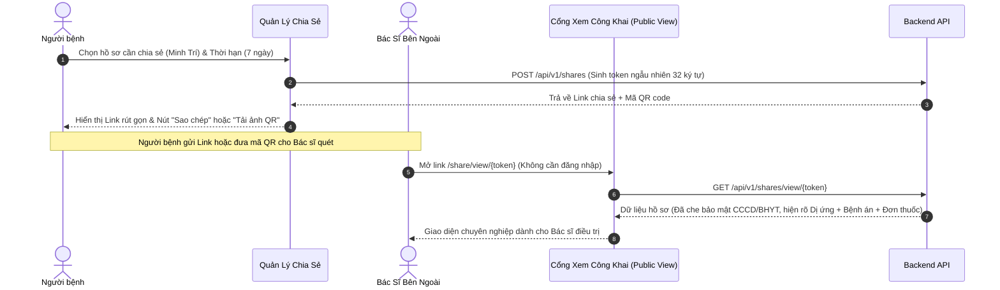

# 🏥 THIẾT KẾ LẠI KIẾN TRÚC & WORKFLOW FRONTEND HỆ THỐNG PHR
## HỆ THỐNG QUẢN LÝ BỆNH ÁN CÁ NHÂN & SỨC KHỎE GIA ĐÌNH

> **Mục tiêu**: Xóa bỏ sự lằng ngoằng, rời rạc của giao diện hiện tại; chuyển đổi sang mô hình **Patient-Centric (Lấy Người Bệnh Làm Trung Tâm)** và **All-in-One Encounter (Gói Gọn Đợt Khám)** giúp người dùng thao tác trực quan, nhanh chóng, đúng với thói quen thực tế khi đi khám bệnh.

---

## 📌 I. PHÂN TÍCH NGUYÊN NHÂN GIAO DIỆN HIỆN TẠI BỊ "LẰNG NGOẰNG"

### 4 Điểm yếu chí mạng của giao diện hiện tại:
1. **Thiếu liên kết đợt khám (Encounter Isolation)**: 
   - Đi khám về người bệnh có: *Giấy khám + Đơn thuốc + Phiếu xét nghiệm + Giấy hẹn*. 
   - Nhưng web hiện tại bắt vào **4 trang khác nhau** ở menu để nhập 4 thứ riêng rẽ.
2. **Lặp lại việc chọn người bệnh (Repetitive Profile Selection)**: 
   - Mỗi trang đều có 1 dropdown chọn người bệnh, không nhớ trạng thái người đang được theo dõi.
3. **Form bệnh án quá nặng tính học thuật y khoa**: 
   - Chia 4 bước với các trường giải phẫu chuyên khoa (tuần hoàn, hô hấp, gây mê, apgar...) khiến người dùng thông thường bị ngợp và khó hoàn thành.
4. **Menu Sidebar quá dài và thiếu phân nhóm**: 
   - 10+ mục xếp hàng dọc không phân cấp rõ ràng theo mục đích sử dụng.

---

## 🧭 II. TỔ CHỨC LẠI CẤU TRÚC GIAO DIỆN (NEW INFORMATION ARCHITECTURE)

### 1. Thanh Điều Hướng Trên Cùng (Global Topbar Hub)
* **Bộ chọn Người Bệnh Toàn Cục (Global Patient Switcher)**: 
  * Chọn `Minh Trí (Bản thân)` ➔ Toàn bộ trang Dashboard, Bệnh án, Đơn thuốc, Chỉ số sẽ tự động đồng bộ theo Minh Trí.
  * Đổi sang `Con: Nguyễn Minh An` ➔ Toàn bộ giao diện chuyển sang dữ liệu của con mà không cần chọn lại ở từng trang.
* **Nút Tác Vụ Nhanh (Quick Action Button) luôn xuất hiện**:
  * `[+ Ghi nhận đợt khám mới]` (Tích hợp chẩn đoán, thuốc, xét nghiệm)
  * `[+ Nhập số đo sinh hiệu]` (Huyết áp, đường huyết, SpO2)

### 2. Tinh Gọn Menu Bên Trái (Sidebar 4 Nhóm Trực Quan)
* **NHÓM 1: TỔNG QUAN**
  * `Bảng Điều Khiển` (`/dashboard`): Dashboard thông minh theo người bệnh đang chọn.
  * `Thành Viên Gia Đình` (`/profiles`): Quản lý danh sách người thân & tiền sử dị ứng/bệnh nền.
* **NHÓM 2: KHÁM CHỮA BỆNH & ĐIỀU TRỊ**
  * `Hồ Sơ Đợt Khám` (`/records`): Dòng thời gian các lần đi viện/khám bệnh, kết hợp xem đơn thuốc & xét nghiệm của từng đợt.
  * `Tủ Thuốc & Đơn Thuốc` (`/prescriptions`): Nhắc nhở uống thuốc và kiểm tra an toàn dị ứng.
  * `Kết Quả Cận Lâm Sàng` (`/clinical`): Kho lưu trữ ảnh X-quang, CT, MRI, kết quả xét nghiệm.
* **NHÓM 3: THEO DÕI SỨC KHỎE TẠI NHÀ**
  * `Chỉ Số Sức Khỏe` (`/metrics`): Biểu đồ huyết áp, đường huyết, BMI, cảnh báo AHA.
  * `Lịch Khám & Tái Khám` (`/appointments`): Lịch hẹn và nhắc nhở ngày đi khám.
* **NHÓM 4: KẾT NỐI & TIỆN ÍCH**
  * `Chia Sẻ Y Tế & QR Khẩn Cấp` (`/shares`): Tạo link/mã QR cho bác sĩ ngoài xem hồ sơ.
  * `Cài Đặt Tài Khoản` (`/settings`): Đổi mật khẩu, thông tin cá nhân.
* *(Phần Quản Trị & Bác Sĩ chỉ hiển thị khi có quyền ROLE_DOCTOR hoặc ROLE_ADMIN)*.

---

## 🔄 III. WORKFLOW CHI TIẾT TỪNG CHỨC NĂNG HỆ THỐNG

---

### 1. WORKFLOW QUẢN LÝ HỒ SƠ THÀNH VIÊN GIA ĐÌNH (PROFILE HUB)

* **Điểm cải tiến**:
  * Chỉ cần nhập thông tin cơ bản là xong, không bắt buộc nhập CCCD/BHYT ngay (nhập sau khi cần).
  * Tiền sử dị ứng hiển thị nổi bật bằng thẻ cảnh báo màu đỏ/cam.

---

### 2. WORKFLOW GHI NHẬN ĐỢT KHÁM BỆNH ÁN (ENCOUNTER MANAGEMENT)

> **Cải tiến lớn nhất**: Cho phép **2 Chế độ nhập liệu**:
> * **Chế độ 1 - Nhập Nhanh Cho Người Dùng (Quick Record)**: Chỉ cần 1 màn hình duy nhất (Tên viện, Ngày khám, Chẩn đoán, kèm chụp ảnh đơn thuốc/kết quả).
> * **Chế độ 2 - Chi Tiết Chuẩn Bộ Y Tế (Full Clinical)**: Dành cho bác sĩ hoặc khi cần lưu trữ chi tiết 7 hệ cơ quan, phẫu thuật, sản khoa.

* **Điểm cải tiến**:
  * Người dùng đi khám phòng khám tư chỉ cần 1 phút là chụp ảnh đơn thuốc, ghi chẩn đoán và lưu xong.
  * Dữ liệu các bước được bảo lưu 100%, có khung tóm tắt hiển thị rõ ràng.

---

### 3. WORKFLOW QUẢN LÝ ĐƠN THUỐC & CẢNH BÁO AN TOÀN (PRESCRIPTIONS)

* **Điểm cải tiến**:
  * Tách biệt rõ: **Thuốc đang uống hằng ngày** (hiển thị to, rõ liều sáng/trưa/chiều/tối) và **Lịch sử các đơn thuốc cũ**.
  * Cảnh báo dị ứng tự động kích hoạt ngay khi gõ tên thuốc.

---

### 4. WORKFLOW KẾT QUẢ XÉT NGHIỆM & CHẨN ĐOÁN HÌNH ẢNH (CLINICAL & LABS)

* **Điểm cải tiến**:
  * Các chỉ số xét nghiệm bất thường tự động được làm nổi bật (màu đỏ) kèm giải thích khoảng an toàn để người bệnh dễ hiểu mà không cần phải có kiến thức chuyên môn sâu.
  * Hỗ trợ xem ảnh trực tiếp (Image Previewer) dạng phóng to/thu nhỏ.

---

### 5. WORKFLOW THEO DÕI CHỈ SỐ SINH HIỆU & CẢNH BÁO SỚM (METRICS)

* **Điểm cải tiến**:
  * Form đo sinh hiệu đặt ngay đầu trang, to rõ, dễ bấm trên cả điện thoại và máy tính.
  * Biểu đồ đường biến thiên có mốc chuẩn rõ ràng (vùng an toàn xanh lá, vùng cảnh báo đỏ).

---

### 6. WORKFLOW ĐẶT LỊCH HẸN & NHẮC TÁI KHÁM (APPOINTMENTS)

* **Điểm cải tiến**:
  * Sau khi bấm "Đã khám xong", hệ thống hỏi người dùng có muốn tạo bệnh án cho lần khám đó ngay không, giúp kết nối liền mạch từ Lịch hẹn ➔ Đợt khám bệnh.

---

### 7. WORKFLOW CHIA SẺ HỒ SƠ & MÃ QR CHO BÁC SĨ (SHARING & EMERGENCY QR)

* **Điểm cải tiến**:
  * Bác sĩ không cần tạo tài khoản, chỉ cần quét QR là nắm toàn bộ tiền sử dị ứng và các đợt khám trước của bệnh nhân trong 5 giây.

---

## 🏗️ IV. LỘ TRÌNH TRIỂN KHAI TỔ CHỨC LẠI FRONTEND

| Giai Đoạn | Nhiệm Vụ Cụ Thể | Mục Tiêu Đạt Được |
| :--- | :--- | :--- |
| **Giai đoạn 1** | Tinh gọn Sidebar Menu & Thêm Global Profile Switcher | Giao diện gọn gàng, người dùng chọn bệnh nhân 1 lần là áp dụng toàn app. |
| **Giai đoạn 2** | Nâng cấp trang Tạo Bệnh Án với 2 chế độ: Nhập Nhanh & Chi Tiết | Người dùng không còn cảm thấy "lằng ngoằng", hoàn thành tạo bệnh án trong 1 phút. |
| **Giai đoạn 3** | Tích hợp liên kết thông minh giữa các trang | Từ Lịch hẹn bấm 1 click sang Bệnh án; từ Bệnh án bấm 1 click thêm Thuốc và File xét nghiệm. |
| **Giai đoạn 4** | Tối ưu Dashboard thành Trung Tâm Điều Phối Y Tế | Trang chủ hiển thị ngay trạng thái sức khỏe của người bệnh đang chọn. |

---
*Tài liệu được xây dựng để làm kim chỉ nam tối ưu hóa toàn diện trải nghiệm người dùng (UX) cho Hệ Thống PHR Việt Nam.*
