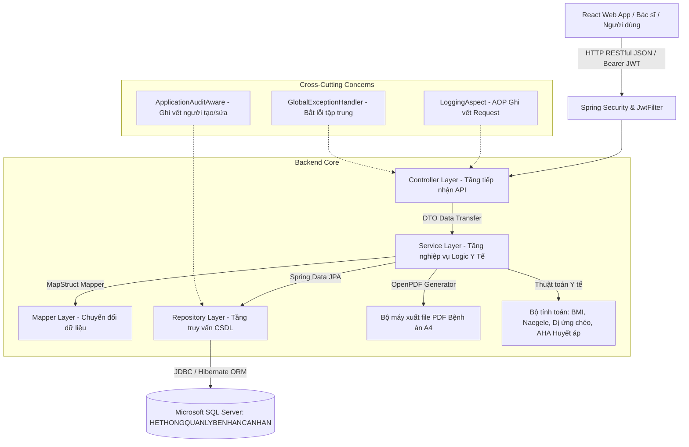

# 📖 SƠ ĐỒ CẤU TRÚC DỰ ÁN & TỪ ĐIỂN GIẢI THÍCH TOÀN BỘ MÃ NGUỒN BACKEND PHR

> **Đề tài**: Hệ Thống Quản Lý Bệnh Án Cá Nhân (Personal Health Record - PHR)  
> **Học phần**: Phân tích thiết kế yêu cầu & Kiến trúc hệ thống phần mềm (PTTKYC)  
> **Công nghệ**: Java 17/21 LTS, Spring Boot 3.2.5, Spring Security 6 (JWT + OTP), Spring Data JPA, Microsoft SQL Server 2022, OpenPDF (LibrePDF), MapStruct, Lombok.  
> **Tiêu chuẩn biểu mẫu y tế tích hợp**: Bộ Y Tế Việt Nam (MS: 01/BV-01 Nội khoa, MS: 02/BV-01 Nhi khoa, MS: 10/BV-01 Ngoại khoa, Chuẩn Sản khoa Naegele).  
> **Cập nhật ngày**: 12/10/2026

---

## 📌 PHẦN 1: BÁO CÁO RÀ SOÁT TỔNG THỂ BACKEND (XÁC NHẬN HOÀN THIỆN 100%)

Sau khi rà soát và kiểm thử thực tế trên cổng **`8088`** kết nối CSDL Microsoft SQL Server **`HETHONGQUANLYBENHANCANHAN`**, hệ thống Backend đã đạt trạng thái **HOÀN TẤT 100% (15/15 Modules)**, không còn tồn đọng thiếu sót nào:

| STT | Nhóm Module | Trạng thái | Đánh giá kiểm thử trực tiếp & Chức năng |
|:---:|---|:---:|---|
| **1** | Xác thực & Tài khoản (Auth & OTP) | 🟢 100% | Đăng ký, Đăng nhập (JWT Access Token + Refresh Token trong Cookie & Body), Đổi mật khẩu, Quên mật khẩu gửi mã OTP 6 số (hiệu lực 15 phút, chống Replay attack). |
| **2** | Hồ sơ cá nhân & Người thân (Health Profile) | 🟢 100% | Quản lý đa hồ sơ thành viên gia đình (Bản thân, Bố mẹ, Vợ/Chồng, Con cái), Nhóm máu, Số thẻ BHYT, CCCD, Tiền sử dị ứng, Bệnh mạn tính nền, Tiền sử bệnh di truyền gia đình. **Chống lỗ hổng IDOR triệt để**. |
| **3** | Bệnh án chung (Core Medical Record) | 🟢 100% | Quản lý bệnh án điện tử, Sinh hiệu lâm sàng (Mạch, Nhiệt độ, Huyết áp, Nhịp thở, SpO2), **Tự động tính BMI**, **Tự động tính số ngày điều trị**, Luân chuyển khoa phòng, Dòng thời gian Timeline. |
| **4** | Chuyên khoa Nội (MS: 01/BV-01) | 🟢 100% | Khám chi tiết 7 hệ cơ quan (Tuần hoàn, Hô hấp, Tiêu hóa, Thận - Tiết niệu, Thần kinh, Cơ xương khớp, Nội tiết), Tóm tắt bệnh mạn tính kết hợp, Kế hoạch dùng thuốc dài ngày. |
| **5** | Chuyên khoa Ngoại (MS: 10/BV-01) | 🟢 100% | Chẩn đoán trước/sau phẫu thuật, Phương pháp vô cảm (Gây mê nội khí quản, Tê tủy sống...), Theo dõi diễn tiến vết mổ & ống dẫn lưu, Ngày rút dẫn lưu, Ngày cắt chỉ. |
| **6** | Chuyên khoa Nhi (MS: 02/BV-01) | 🟢 100% | Thông tin học vấn và nghề nghiệp của bố mẹ, Chỉ số phát triển sơ sinh (Tuổi thai tuần, Cân nặng sinh, Chỉ số Apgar 1 phút & 5 phút), Phương pháp sinh, Chế độ nuôi dưỡng. |
| **7** | Chuyên khoa Sản (Chuẩn Sản khoa) | 🟢 100% | **Ràng buộc giới tính Nữ bắt buộc**, Tiền sử sản khoa PARA 4 số, **Thuật toán Naegele tự động tính Ngày dự sinh (EDD = Kinh cuối + 7 ngày - 3 tháng + 1 năm)**, Tự động tính Tuổi thai theo tuần. |
| **8** | Đơn thuốc & Cảnh báo dị ứng chéo | 🟢 100% | Kê đơn thuốc, Tra cứu danh mục dược phẩm, **Thuật toán tự động phát hiện phản ứng dị ứng thuốc chéo** (Ví dụ: Dị ứng Penicillin ➔ Cảnh báo nguy cơ sốc phản vệ khi kê Amoxicillin), Danh sách thuốc đang sử dụng. |
| **9** | Cận lâm sàng & Tệp đính kèm (Clinical) | 🟢 100% | Kết quả xét nghiệm huyết học, sinh hóa (Tự động bật cờ `abnormal` bất thường), Chẩn đoán hình ảnh (X-quang, CT Scanner, MRI, Siêu âm, Điện tim), Quản lý tệp PDF và ảnh scan y tế. |
| **10** | Chia sẻ hồ sơ bệnh án (Profile Share) | 🟢 100% | Sinh mã bảo mật ngẫu nhiên UUID 32 ký tự, Cài đặt thời hạn hiệu lực linh hoạt (giờ/ngày), Phân quyền truy cập (Chỉ xem / Đầy đủ), Endpoint công khai xác minh token cho Bác sĩ không cần đăng nhập. |
| **11** | Chỉ số sức khỏe tại nhà (Home Metrics) | 🟢 100% | Ghi nhận Huyết áp, Đường huyết, Nhịp tim, Cân nặng, SpO2. **Thuật toán tự động đánh giá phân loại y khoa**: Huyết áp chuẩn AHA (Tối ưu/Tiền tăng/Độ 1/Độ 2), Tự đổi đơn vị mmol/L sang mg/dL, Cảnh báo SpO2 < 94%, Bảng tổng hợp Dashboard. |
| **12** | Lịch hẹn khám & Tái khám (Appointments) | 🟢 100% | Đặt lịch khám, Lịch tái khám gắn liền đợt điều trị, Lịch tiêm chủng mở rộng, Quản lý vòng đời trạng thái (`SCHEDULED`, `COMPLETED`, `CANCELLED`). |
| **13** | Ghi chú Bác sĩ (Doctor Notes) | 🟢 100% | Bác sĩ ghi nhận xét và đánh giá chuyên môn độc lập vào bệnh án, Phân quyền RBAC nghiêm ngặt bằng chú thích `@PreAuthorize("hasAnyRole('DOCTOR', 'ADMIN')")`. |
| **14** | Xuất PDF bệnh án chuẩn Bộ Y Tế (PDF Export) | 🟢 100% | Sử dụng thư viện **OpenPDF** tạo file PDF tóm tắt bệnh án chuẩn A4 gồm 6 khối thông tin: Quốc hiệu tiêu ngữ & Hành chính, Diễn tiến điều trị, Bảng sinh hiệu, Bảng đơn thuốc, Tóm tắt & Lời dặn ra viện, Chữ ký xác nhận. |
| **15** | Danh mục ICD-10 & Thuốc mẫu (Catalogs) | 🟢 100% | Tìm kiếm mã bệnh quốc tế ICD-10 chuẩn WHO theo mã hoặc tên bệnh, Tra cứu danh mục hoạt chất thuốc, API quản trị viên bổ sung dữ liệu danh mục. |

---

## 🏗️ PHẦN 2: SƠ ĐỒ KIẾN TRÚC TỔNG THỂ HỆ THỐNG (SYSTEM ARCHITECTURE)

### 1. Kiến trúc phân tầng (Layered Architecture Diagram)


---

## 🌳 PHẦN 3: SƠ ĐỒ CẤY THƯ MỤC CHI TIẾT (PROJECT DIRECTORY TREE)

```text
scratch/backend/
├── build.gradle                                   # Cấu hình Gradle (Java 17/21, Spring Boot 3.2.5, OpenPDF, MSSQL, MapStruct)
├── settings.gradle                                # Khai báo tên dự án: temp (Hệ thống PHR)
├── src/
│   └── main/
│       ├── java/com/spring/temp/
│       │   ├── SpringTempApplication.java         # Lớp khởi chạy chính của hệ thống Spring Boot
│       │   │
│       │   ├── aop/                               # Tầng khía cạnh AOP (Aspect-Oriented Programming)
│       │   │   └── LoggingAspect.java             # Tự động ghi vết log mỗi khi có request gọi vào Controller/Service
│       │   │
│       │   ├── auth/                              # Phân hệ Xác thực & Quản lý phiên làm việc
│       │   │   ├── AuthenticationController.java  # Controller tiếp nhận Đăng ký, Đăng nhập, Đổi/Quên mật khẩu
│       │   │   ├── AuthenticationRequest.java     # DTO nhận email & password đăng nhập
│       │   │   ├── AuthenticationResponse.java    # DTO trả về JWT Token, Refresh Token & thông tin tài khoản
│       │   │   ├── AuthenticationService.java     # Logic xác thực, băm BCrypt, sinh mã OTP 6 số
│       │   │   ├── ChangePasswordRequest.java     # DTO đổi mật khẩu (mật khẩu hiện tại, mật khẩu mới)
│       │   │   ├── ForgotPasswordRequest.java     # DTO yêu cầu gửi mã OTP quên mật khẩu qua email
│       │   │   ├── RegistrationRequest.java       # DTO đăng ký tài khoản người dùng mới
│       │   │   ├── ResetPasswordRequest.java      # DTO xác thực OTP và nhập mật khẩu mới
│       │   │   ├── UserSummaryResponse.java       # DTO tóm tắt người dùng hiện tại (/me)
│       │   │   └── VerifyResetCodeRequest.java    # DTO kiểm tra tính hợp lệ của mã OTP
│       │   │
│       │   ├── config/                            # Cấu hình hệ thống chung
│       │   │   ├── ApplicationAuditAware.java     # Tự động trích xuất userId cho JPA Auditing (CreatedBy, LastModifiedBy)
│       │   │   ├── BeansConfig.java               # Đăng ký các Bean cốt lõi: AuthenticationManager, BCryptPasswordEncoder
│       │   │   ├── DataInitializer.java           # Seeder tự động nạp dữ liệu mẫu ban đầu vào SQL Server (Roles, Admin, ICD-10, Thuốc)
│       │   │   └── OpenApiConfig.java             # Cấu hình giao diện Swagger OpenAPI 3.0 với chứng thực Bearer JWT
│       │   │
│       │   ├── domain/                            # Trọng tâm nghiệp vụ Y tế & Bệnh án cá nhân
│       │   │   ├── controller/                    # Tầng Controller tiếp nhận API RESTful
│       │   │   │   ├── AuditLogController.java             # API tra cứu nhật ký kiểm toán hệ thống (dành cho Admin)
│       │   │   │   ├── CatalogController.java              # API tra cứu danh mục ICD-10 và Danh mục dược phẩm
│       │   │   │   ├── ClinicalInvestigationController.java# API quản lý Xét nghiệm, Chẩn đoán hình ảnh, Tệp đính kèm
│       │   │   │   ├── DoctorNoteController.java           # API cho Bác sĩ ghi nhận xét chuyên môn độc lập
│       │   │   │   ├── HealthMetricController.java         # API theo dõi chỉ số sức khỏe tự đo tại nhà & Dashboard
│       │   │   │   ├── HealthProfileController.java        # API quản lý Hồ sơ sức khỏe người thân, Dị ứng, Bệnh nền
│       │   │   │   ├── MedicalAppointmentController.java   # API đặt lịch khám, lịch tái khám, tiêm chủng
│       │   │   │   ├── MedicalRecordController.java        # API Bệnh án chung, 4 chuyên khoa, Sinh hiệu, Xuất PDF
│       │   │   │   ├── PrescriptionController.java         # API kê đơn thuốc, tra cứu đơn thuốc, cảnh báo dị ứng
│       │   │   │   └── ProfileShareController.java         # API chia sẻ hồ sơ bệnh án bằng liên kết bảo mật Token
│       │   │   │
│       │   │   ├── dto/                           # Tầng đóng gói truyền tải dữ liệu (Data Transfer Objects)
│       │   │   │   ├── appointment/               # DTO Lịch hẹn khám (Request, Response)
│       │   │   │   ├── audit/                     # DTO Nhật ký kiểm toán
│       │   │   │   ├── clinical/                  # DTO Xét nghiệm lâm sàng, CĐHA, Tệp đính kèm
│       │   │   │   ├── common/                    # DTO Envelope phản hồi chuẩn: ApiResponse<T>, PageResponse<T>
│       │   │   │   ├── doctornote/                # DTO Ghi chú chuyên môn của Bác sĩ
│       │   │   │   ├── medicalrecord/             # DTO Bệnh án chung, Sinh hiệu, Luân chuyển khoa, 4 Chuyên khoa
│       │   │   │   ├── metric/                    # DTO Chỉ số đo tại nhà và Bảng tóm tắt Dashboard
│       │   │   │   ├── prescription/              # DTO Đơn thuốc, Chi tiết thuốc, Thuốc đang dùng
│       │   │   │   ├── profile/                   # DTO Hồ sơ sức khỏe, Dị ứng, Bệnh mạn tính, Tiền sử gia đình
│       │   │   │   └── share/                     # DTO Chia sẻ hồ sơ bệnh án
│       │   │   │
│       │   │   ├── mapper/                        # Tầng ánh xạ dữ liệu tự động giữa Entity và DTO (MapStruct)
│       │   │   │   ├── HealthProfileMapper.java   # Chuyển đổi dữ liệu Hồ sơ sức khỏe, Dị ứng, Tiền sử bệnh
│       │   │   │   ├── MedicalRecordMapper.java   # Chuyển đổi dữ liệu Bệnh án điện tử và các Biểu mẫu chuyên khoa
│       │   │   │   └── PrescriptionMapper.java    # Chuyển đổi dữ liệu Đơn thuốc và Chi tiết từng mục thuốc
│       │   │   │
│       │   │   ├── model/                         # Tầng thực thể CSDL JPA (Ánh xạ 34 bảng trong SQL Server)
│       │   │   │   ├── enums/                     # 18 Định dạng danh mục Enum chuẩn Bộ Y Tế & Hệ thống
│       │   │   │   │   ├── AdministrationRoute.java    # Đường dùng thuốc (Uống, Tiêm bắp, Tiêm tĩnh mạch, Bôi ngoài...)
│       │   │   │   │   ├── AdmissionGate.java          # Cổng vào viện (Khoa Khám bệnh, Cấp cứu, Chuyển viện...)
│       │   │   │   │   ├── AdmissionType.java          # Loại nhập viện (Cấp cứu, Khám bệnh, Chuyển tuyến)
│       │   │   │   │   ├── AllergySeverity.java        # Mức độ dị ứng (Nhẹ, Trung bình, Nặng / Nguy kịch)
│       │   │   │   │   ├── AllergyType.java            # Nhóm tác nhân dị ứng (Thuốc, Thức ăn, Côn trùng, Khác)
│       │   │   │   │   ├── AppointmentStatus.java      # Trạng thái lịch hẹn (SCHEDULED, COMPLETED, CANCELLED)
│       │   │   │   │   ├── AppointmentType.java        # Loại hình hẹn khám (Khám mới, Tái khám, Tiêm chủng)
│       │   │   │   │   ├── DischargeType.java          # Hình thức ra viện (Khỏi bệnh, Đỡ/Giảm, Nặng hơn, Chuyển viện, Tử vong)
│       │   │   │   │   ├── Gender.java                 # Giới tính (MALE, FEMALE, OTHER)
│       │   │   │   │   ├── InsuranceType.java          # Nhóm đối tượng BHYT (Học sinh/Sinh viên, Hộ nghèo, Doanh nghiệp...)
│       │   │   │   │   ├── MetricType.java             # Loại chỉ số sức khỏe đo tại nhà (Huyết áp, Đường huyết, SpO2, Nhịp tim, Cân nặng)
│       │   │   │   │   ├── RecordType.java             # Loại hồ sơ y tế (Nội khoa, Ngoại khoa, Nhi khoa, Sản khoa, Khám chung)
│       │   │   │   │   ├── ReferralSource.java         # Tuyến gửi bệnh nhân đến (Y tế cơ sở, Tự đến, Bệnh viện bạn)
│       │   │   │   │   ├── RelationshipType.java       # Mối quan hệ thân nhân (Bản thân, Bố/Mẹ, Con, Vợ/Chồng, Anh chị em)
│       │   │   │   │   ├── SharePermissionScope.java   # Phạm vi cấp quyền chia sẻ (Chỉ xem READ_ONLY, Toàn quyền FULL_ACCESS)
│       │   │   │   │   ├── ShareStatus.java            # Trạng thái liên kết chia sẻ (ACTIVE - Đang hiệu lực, REVOKED - Đã thu hồi)
│       │   │   │   │   ├── TransferredLevel.java       # Tuyến chuyển viện (Tuyến xã, Tuyến huyện, Tuyến tỉnh, Tuyến Trung ương)
│       │   │   │   │   └── VaccinationStatus.java      # Trạng thái mũi tiêm (Đã tiêm, Chưa tiêm, Quá hạn)
│       │   │   │   │
│       │   │   │   ├── User.java                  # Thực thể tài khoản đăng nhập, thông tin định danh người dùng
│       │   │   │   ├── Role.java                  # Thực thể vai trò người dùng (ROLE_USER, ROLE_DOCTOR, ROLE_ADMIN)
│       │   │   │   ├── Token.java                 # Thực thể quản lý mã OTP và mã khóa JWT Refresh
│       │   │   │   ├── HealthProfile.java         # Thực thể Hồ sơ sức khỏe cá nhân và người thân trong gia đình
│       │   │   │   ├── Allergy.java               # Thực thể Tiền sử dị ứng thuốc / thực phẩm
│       │   │   │   ├── ChronicDisease.java        # Thực thể Tiền sử bệnh mạn tính đang điều trị
│       │   │   │   ├── FamilyMedicalHistory.java  # Thực thể Tiền sử bệnh di truyền gia đình
│       │   │   │   ├── MedicalRecord.java         # Thực thể Bệnh án dùng chung chuẩn Bộ Y Tế
│       │   │   │   ├── VitalSigns.java            # Thực thể Chỉ số sinh hiệu lâm sàng (Mạch, Huyết áp, BMI, SpO2)
│       │   │   │   ├── DepartmentTransfer.java    # Thực thể Luân chuyển khoa phòng điều trị nội trú
│       │   │   │   ├── InternalRecordDetail.java  # Thực thể Chi tiết chuyên khoa NỘI KHOA (MS: 01/BV-01 - 7 hệ cơ quan)
│       │   │   │   ├── SurgicalRecordDetail.java  # Thực thể Chi tiết chuyên khoa NGOẠI KHOA (MS: 10/BV-01 - Phẫu thuật, vết mổ)
│       │   │   │   ├── PediatricRecordDetail.java # Thực thể Chi tiết chuyên khoa NHI KHOA (MS: 02/BV-01 - Bố mẹ, sơ sinh, Apgar)
│       │   │   │   ├── ObstetricRecordDetail.java # Thực thể Chi tiết chuyên khoa SẢN KHOA (PARA, Ngày dự sinh Naegele)
│       │   │   │   ├── Prescription.java          # Thực thể Đơn thuốc điều trị ngoại trú / xuất viện
│       │   │   │   ├── PrescriptionItem.java      # Thực thể Chi tiết từng loại thuốc kê trong đơn
│       │   │   │   ├── MedicineCatalog.java       # Thực thể Danh mục dược phẩm quốc gia (biệt dược, hoạt chất)
│       │   │   │   ├── LabTestResult.java         # Thực thể Kết quả xét nghiệm sinh hóa, huyết học
│       │   │   │   ├── ImagingResult.java         # Thực thể Kết quả chẩn đoán hình ảnh (X-quang, CT, MRI, Siêu âm)
│       │   │   │   ├── MedicalAttachment.java     # Thực thể Tệp đính kèm y tế (PDF phiếu khám, ảnh chụp scan)
│       │   │   │   ├── HealthMetric.java          # Thực thể Chỉ số sức khỏe tự đo tại nhà
│       │   │   │   ├── MedicalAppointment.java    # Thực thể Lịch hẹn khám bệnh và tái khám
│       │   │   │   ├── ProfileShare.java          # Thực thể Liên kết chia sẻ hồ sơ bệnh án qua Token
│       │   │   │   ├── DoctorNote.java            # Thực thể Ghi chú nhận xét chuyên môn của Bác sĩ
│       │   │   │   ├── AuditLog.java              # Thực thể Nhật ký kiểm toán truy vết thao tác an ninh
│       │   │   │   └── Icd10Catalog.java          # Thực thể Danh mục mã bệnh quốc tế ICD-10
│       │   │   │
│       │   │   ├── repository/                # Tầng truy vấn CSDL (32 Spring Data JPA Repositories)
│       │   │   │   ├── AllergyRepository.java               # Truy vấn tiền sử dị ứng theo hồ sơ (kèm lọc xóa mềm)
│       │   │   │   ├── AuditLogRepository.java              # Truy vấn nhật ký kiểm toán theo người dùng hoặc thời gian
│       │   │   │   ├── ChronicDiseaseRepository.java        # Truy vấn bệnh mạn tính nền
│       │   │   │   ├── DepartmentTransferRepository.java    # Truy vấn lịch sử chuyển khoa phòng
│       │   │   │   ├── DoctorNoteRepository.java            # Truy vấn ghi chú chuyên môn của bác sĩ theo bệnh án
│       │   │   │   ├── FamilyMedicalHistoryRepository.java  # Truy vấn tiền sử bệnh tật trong gia đình
│       │   │   │   ├── HealthMetricRepository.java          # Truy vấn chuỗi đo lường chỉ số sức khỏe tại nhà
│       │   │   │   ├── HealthProfileRepository.java         # Truy vấn hồ sơ sức khỏe thuộc sở hữu của người dùng
│       │   │   │   ├── Icd10CatalogRepository.java          # Tìm kiếm danh mục mã bệnh ICD-10 theo từ khóa
│       │   │   │   ├── ImagingResultRepository.java         # Truy vấn kết quả chẩn đoán hình ảnh
│       │   │   │   ├── InternalRecordDetailRepository.java  # Truy vấn dữ liệu chi tiết bệnh án Nội khoa
│       │   │   │   ├── LabTestResultRepository.java         # Truy vấn kết quả xét nghiệm cận lâm sàng
│       │   │   │   ├── MedicalAppointmentRepository.java    # Truy vấn lịch hẹn theo trạng thái và thời gian
│       │   │   │   ├── MedicalAttachmentRepository.java     # Truy vấn tệp đính kèm y tế theo bệnh án
│       │   │   │   ├── MedicalRecordRepository.java         # Truy vấn hồ sơ bệnh án phân trang và chi tiết
│       │   │   │   ├── MedicineCatalogRepository.java       # Tìm kiếm thuốc theo tên hoạt chất hoặc tên biệt dược
│       │   │   │   ├── ObstetricRecordDetailRepository.java # Truy vấn dữ liệu chi tiết bệnh án Sản khoa
│       │   │   │   ├── PediatricRecordDetailRepository.java # Truy vấn dữ liệu chi tiết bệnh án Nhi khoa
│       │   │   │   ├── PrescriptionItemRepository.java      # Truy vấn chi tiết các mục thuốc trong đơn
│       │   │   │   ├── PrescriptionRepository.java          # Truy vấn đơn thuốc kèm liên kết bệnh án
│       │   │   │   ├── ProfileShareRepository.java          # Tìm kiếm liên kết chia sẻ theo mã Token bí mật
│       │   │   │   ├── RoleRepository.java                  # Tìm kiếm vai trò người dùng (ROLE_USER, ROLE_ADMIN...)
│       │   │   │   ├── SurgicalRecordDetailRepository.java  # Truy vấn dữ liệu chi tiết bệnh án Ngoại khoa
│       │   │   │   ├── TokenRepository.java                 # Tìm kiếm mã xác thực OTP hoặc JWT Token
│       │   │   │   ├── UserRepository.java                  # Tìm kiếm tài khoản người dùng theo email đăng nhập
│       │   │   │   └── VitalSignsRepository.java            # Truy vấn chuỗi theo dõi sinh hiệu bệnh nhân
│       │   │   │
│       │   │   └── service/                   # Tầng thực thi nghiệp vụ chính (Business Logic Services)
│       │   │       ├── AuditLogService.java             # Ghi nhận hành động thao tác và truy xuất log kiểm toán
│       │   │       ├── ClinicalInvestigationService.java# Quản lý kết quả xét nghiệm, CĐHA, lưu trữ tệp đính kèm
│       │   │       ├── DoctorNoteService.java           # Thêm và hiển thị ghi chú chuyên môn của bác sĩ
│       │   │       ├── HealthMetricService.java         # Lưu chỉ số đo tại nhà, tự động đánh giá phân loại AHA/ADA
│       │   │       ├── HealthProfileService.java        # Xử lý CRUD hồ sơ, kiểm tra quyền sở hữu chống IDOR
│       │   │       ├── MedicalAppointmentService.java   # Đặt lịch hẹn, quản lý trạng thái và danh sách lịch sắp tới
│       │   │       ├── MedicalRecordPdfService.java     # Sinh tài liệu tóm tắt bệnh án ra PDF chuẩn A4 (OpenPDF)
│       │   │       ├── MedicalRecordService.java        # Xử lý bệnh án 4 chuyên khoa, Naegele, BMI, luân chuyển khoa
│       │   │       ├── PrescriptionService.java         # Kê đơn thuốc, thuật toán phát hiện dị ứng thuốc chéo
│       │   │       └── ProfileShareService.java         # Sinh mã token chia sẻ và kiểm tra xác thực quyền truy cập
│       │   │
│       │   ├── email/                             # Dịch vụ gửi thư điện tử Email
│       │   │   ├── EmailController.java           # Endpoint hỗ trợ kiểm thử gửi email
│       │   │   ├── EmailService.java              # Logic kết nối SMTP gửi email mã OTP xác thực
│       │   │   └── EmailTemplateName.java         # Enum định nghĩa tên mẫu giao diện email (Thymeleaf/HTML)
│       │   │
│       │   ├── exception/                         # Định nghĩa các ngoại lệ tùy chỉnh của hệ thống
│       │   │   ├── NotFoundException.java         # Báo lỗi 404 khi không tìm thấy tài nguyên trong CSDL
│       │   │   ├── SomethingWentWrongException.java# Báo lỗi nội bộ hệ thống 500
│       │   │   └── UserNotFoundException.java     # Báo lỗi khi tài khoản người dùng không tồn tại
│       │   │
│       │   ├── handler/                           # Tầng xử lý lỗi tập trung toàn cục (Global Exception Handling)
│       │   │   ├── ErrorCodes.java                # Bảng mã lỗi tiêu chuẩn của hệ thống (AUTH_ERROR, NOT_FOUND...)
│       │   │   ├── ExceptionResponse.java         # Cấu trúc phản hồi lỗi dạng JSON
│       │   │   └── GlobalExceptionHandler.java    # Bắt lỗi toàn cục @RestControllerAdvice, trả về ApiResponse chuẩn
│       │   │
│       │   └── security/                          # Tầng bảo mật Spring Security & JWT
│       │       ├── JwtFilter.java                 # Bộ lọc chặn mọi HTTP Request để kiểm tra tính hợp lệ của Bearer JWT
│       │       ├── JwtService.java                # Dịch vụ mã hóa, ký và giải mã JWT token (HMAC-SHA256)
│       │       ├── SecurityConfig.java            # Cấu hình chuỗi lọc Security, Whitelist API công khai, Tắt CSRF, CORS
│       │       └── UserDetailsServiceImpl.java    # Cung cấp phương thức nạp UserDetails từ CSDL theo email cho Spring Security
│       │
│       └── resources/                             # Tài nguyên cấu hình ứng dụng
│           ├── application.properties             # Cấu hình Spring Boot mặc định
│           └── application-dev.properties         # Cấu hình cổng 8088, chuỗi kết nối MS SQL Server và tài khoản sa
```

---

## 📚 PHẦN 4: TỪ ĐIỂN TÊN TỆP TIN & VAI TRÒ MÃ NGUỒN (CHUYÊN SÂU TỪNG FILE)

Bảng phân loại chi tiết 100% các tệp tin trong hệ thống, dịch nghĩa sang tiếng Việt, xác định tầng kiến trúc và mô tả chức năng nghiệp vụ của từng file:

### 1. Phân hệ Xác thực & Bảo mật (Authentication & Security)

| Tên tệp tin | Tên tiếng Việt dịch nghĩa | Tầng (Layer) | Chức năng chi tiết & Vai trò của mã nguồn |
|---|---|:---:|---|
| `SecurityConfig.java` | Lớp cấu hình bảo mật hệ thống | Security Config | Cấu hình trung tâm của Spring Security 6. Mở quyền tự do (*permitAll*) cho các API `/api/v1/auth/**`, Swagger UI `/swagger-ui/**`, và API kiểm tra token chia sẻ `/api/v1/shares/verify/**`. Bật phân quyền theo vai trò `@EnableMethodSecurity`. Cấu hình quản lý phiên không trạng thái (*Stateless Session*). |
| `JwtFilter.java` | Bộ lọc chặn mã khóa JWT | Security Filter | Đón đầu mọi yêu cầu HTTP gửi đến máy chủ. Đọc Header `Authorization: Bearer <token>`, trích xuất email người dùng, kiểm tra chữ ký số và nạp đối tượng quyền hạn `UsernamePasswordAuthenticationToken` vào `SecurityContextHolder`. |
| `JwtService.java` | Dịch vụ sinh và đọc mã JWT | Security Service | Chịu trách nhiệm ký số JWT bằng thuật toán HMAC-SHA256 với khóa bí mật 256-bit. Sinh Access Token (thời hạn 24h), Refresh Token (thời hạn 7 ngày), và trích xuất các thông tin định danh (userId, email, roles). |
| `UserDetailsServiceImpl.java` | Dịch vụ nạp thông tin người dùng | Security Service | Cài đặt interface `UserDetailsService` của Spring Security. Tìm kiếm người dùng trong SQL Server qua `UserRepository.findByEmail()`, trả về thực thể User cài đặt `UserDetails`. |
| `AuthenticationController.java` | Bộ điều khiển giao tiếp xác thực | REST Controller | Cung cấp các cổng API cho ứng dụng khách: `/register` (Đăng ký tài khoản), `/authenticate` (Đăng nhập), `/change-password` (Đổi mật khẩu), `/forgot-password` (Quên mật khẩu), `/verify-reset-code` (Kiểm tra OTP), `/reset-password` (Đặt lại mật khẩu), `/me` (Lấy thông tin tài khoản đang đăng nhập). |
| `AuthenticationService.java` | Dịch vụ xử lý nghiệp vụ xác thực | Service | Thực hiện mã hóa mật khẩu bằng BCrypt; Kiểm tra tính hợp lệ của tài khoản; Sinh ngẫu nhiên mã OTP gồm 6 chữ số có thời hạn 15 phút lưu vào bảng `Token`; Thu hồi các token cũ; Ngăn chặn tấn công thử mã lặp đi lặp lại (*brute force/replay attack*). |
| `AuthenticationRequest.java` | Đối tượng yêu cầu đăng nhập | DTO | Đóng gói 2 trường dữ liệu bắt buộc khi gửi đăng nhập: `email` và `password`. |
| `AuthenticationResponse.java` | Đối tượng phản hồi sau đăng nhập | DTO | Đóng gói kết quả trả về cho Frontend: chuỗi JWT `token`, `refreshToken`, `userId`, `email`, `fullName`, `phone`, và danh sách vai trò `roles`. |
| `RegistrationRequest.java` | Đối tượng yêu cầu đăng ký tài khoản | DTO | Đóng gói thông tin form tạo tài khoản: `firstname`, `lastname`, `email`, `password`, `phone`, `dateOfBirth`. |
| `ForgotPasswordRequest.java` | Đối tượng yêu cầu quên mật khẩu | DTO | Chứa địa chỉ `email` của tài khoản cần lấy lại mật khẩu. |
| `VerifyResetCodeRequest.java` | Đối tượng yêu cầu kiểm tra mã OTP | DTO | Chứa `email` và `code` OTP 6 chữ số để xác thực tính hợp lệ trước khi cho phép người dùng đổi mật khẩu. |
| `ResetPasswordRequest.java` | Đối tượng yêu cầu đặt lại mật khẩu mới | DTO | Chứa `email`, `code` OTP hợp lệ và `newPassword` cần thiết lập lại. |
| `ChangePasswordRequest.java` | Đối tượng yêu cầu đổi mật khẩu | DTO | Chứa `currentPassword`, `newPassword` và `confirmationPassword` khi người dùng chủ động đổi mật khẩu trong trang cá nhân. |
| `UserSummaryResponse.java` | Đối tượng tóm tắt thông tin tài khoản | DTO | Trả về thông tin ngắn gọn của người dùng hiện tại đang đăng nhập qua API `/api/v1/auth/me`. |

---

### 2. Phân hệ Hồ sơ sức khỏe & Tiền sử bệnh gia đình (Health Profile)

| Tên tệp tin | Tên tiếng Việt dịch nghĩa | Tầng (Layer) | Chức năng chi tiết & Vai trò của mã nguồn |
|---|---|:---:|---|
| `HealthProfileController.java` | Bộ điều khiển Hồ sơ sức khỏe | REST Controller | Tiếp nhận các thao tác CRUD hồ sơ người thân (`/api/v1/profiles`), quản lý danh sách tiền sử dị ứng (`/allergies`), tiền sử bệnh mạn tính (`/chronic-diseases`), và tiền sử di truyền gia đình (`/family-histories`). |
| `HealthProfileService.java` | Dịch vụ quản lý Hồ sơ sức khỏe | Business Service | **Bảo mật & Chống lỗ hổng IDOR**: Kiểm tra nghiêm ngặt `profile.getUser().getId().equals(currentUser.getId())` để đảm bảo người dùng chỉ được xem/sửa hồ sơ thuộc gia đình mình; Thực hiện cơ chế xóa mềm (*soft-delete*); Lưu trữ và truy xuất lịch sử dị ứng và bệnh nền. |
| `HealthProfile.java` | Thực thể Hồ sơ sức khỏe | JPA Entity | Ánh xạ tới bảng `health_profiles` trong SQL Server. Lưu trữ: Họ tên, Ngày sinh, Giới tính, Quan hệ gia đình (*Bản thân, Bố/Mẹ, Con, Vợ/Chồng*), Nhóm máu, Số CCCD, Mã thẻ BHYT, Địa chỉ, Số điện thoại liên hệ khẩn cấp. |
| `Allergy.java` | Thực thể Tiền sử dị ứng | JPA Entity | Ánh xạ bảng `allergies`. Lưu trữ: Tên chất gây dị ứng (*Penicillin, Tôm, Đậu phộng...*), Loại dị ứng (*Thuốc, Thực phẩm, Môi trường*), Mức độ nghiêm trọng (*Nhẹ, Trung bình, Nguy kịch/Sốc phản vệ*), Triệu chứng thường gặp. |
| `ChronicDisease.java` | Thực thể Bệnh mạn tính nền | JPA Entity | Ánh xạ bảng `chronic_diseases`. Lưu trữ: Tên bệnh mạn tính (*Đái tháo đường Type 2, Tăng huyết áp, Hen suyễn...*), Năm phát hiện chẩn đoán, Tình trạng điều trị hiện tại, Phác đồ thuốc duy trì. |
| `FamilyMedicalHistory.java` | Thực thể Tiền sử bệnh gia đình | JPA Entity | Ánh xạ bảng `family_medical_histories`. Lưu trữ các bệnh lý di truyền của người thân thế hệ trước (*Ung thư đại trực tràng, Bệnh mạch vành, Đột quỵ...*) và mối quan hệ huyết thống. |
| `HealthProfileRequest.java` | Đối tượng yêu cầu tạo/sửa hồ sơ | DTO | Đóng gói và kiểm tra ràng buộc dữ liệu đầu vào: Họ tên không được để trống, Ngày sinh hợp lệ, Giới tính đúng quy chuẩn. |
| `HealthProfileResponse.java` | Đối tượng phản hồi chi tiết hồ sơ | DTO | Trả về thông tin hồ sơ kèm danh sách dị ứng, bệnh nền và tiền sử gia đình cho Frontend hiển thị. |
| `AllergyDto.java` | Đối tượng truyền tải dữ liệu Dị ứng | DTO | Đóng gói thông tin chất dị ứng, nhóm dị ứng và mức độ phản vệ. |
| `ChronicDiseaseDto.java` | Đối tượng dữ liệu Bệnh mạn tính | DTO | Đóng gói thông tin bệnh mạn tính nền của người bệnh. |
| `FamilyMedicalHistoryDto.java` | Đối tượng dữ liệu Tiền sử gia đình | DTO | Đóng gói thông tin bệnh di truyền của các thế hệ trong gia đình. |
| `HealthProfileMapper.java` | Bộ chuyển đổi dữ liệu Hồ sơ MapStruct | Mapper | Tự động chuyển đổi dữ liệu hai chiều giữa `HealthProfile` Entity và `HealthProfileResponse` DTO với hiệu năng cực cao ở tầng biên dịch. |

---

### 3. Phân hệ Bệnh án điện tử & 4 Biểu mẫu chuyên khoa Bộ Y Tế (Medical Records)

| Tên tệp tin | Tên tiếng Việt dịch nghĩa | Tầng (Layer) | Chức năng chi tiết & Vai trò của mã nguồn |
|---|---|:---:|---|
| `MedicalRecordController.java` | Bộ điều khiển Bệnh án điện tử | REST Controller | Cung cấp 10 API RESTful: Tạo bệnh án mới theo chuyên khoa, Lấy danh sách bệnh án phân trang, Xem chi tiết bệnh án, Cập nhật bệnh án, Thêm sinh hiệu đo đạc, Thêm luân chuyển khoa phòng, Xem dòng thời gian Timeline điều trị, và **Xuất bệnh án ra PDF chuẩn A4**. |
| `MedicalRecordService.java` | Dịch vụ nghiệp vụ Bệnh án điện tử | Business Service | **Trái tim nghiệp vụ y khoa**: Tự động tính chỉ số BMI theo cân nặng/chiều cao; Tự động tính số ngày nằm viện điều trị; Ràng buộc giới tính Nữ cho bệnh án Sản khoa; Áp dụng công thức y khoa **Naegele** tự động tính Ngày dự sinh (EDD) và Tuổi thai tuần; Xử lý luân chuyển khoa nội trú. |
| `MedicalRecord.java` | Thực thể Bệnh án dùng chung | JPA Entity | Ánh xạ bảng `medical_records`. Lưu trữ thông tin hành chính & điều trị cốt lõi: Mã bệnh án, Số lưu trữ hồ sơ, Mã số y tế, Khoa điều trị hiện tại, Số buồng/giường, Bác sĩ điều trị chính, Tuyến chuyển, Lý do vào viện, Chẩn đoán vào/ra viện, Mã bệnh ICD-10 chính và kèm theo. |
| `VitalSigns.java` | Thực thể Sinh hiệu lâm sàng | JPA Entity | Ánh xạ bảng `vital_signs`. Lưu trữ diễn tiến các chỉ số sinh tồn của bệnh nhân: Mạch (lần/phút), Thân nhiệt (°C), Huyết áp tâm thu / tâm trương (mmHg), Nhịp thở, Nồng độ oxy SpO2 (%), Chiều cao (cm), Cân nặng (kg), Chỉ số khối cơ thể BMI. |
| `DepartmentTransfer.java` | Thực thể Luân chuyển khoa phòng | JPA Entity | Ánh xạ bảng `department_transfers`. Lưu lại lịch sử di chuyển khoa điều trị nội trú của bệnh nhân: Khoa chuyển đi, Khoa tiếp nhận, Thời điểm chuyển, Lý do chuyển khoa. |
| `InternalRecordDetail.java` | Thực thể Chi tiết Bệnh án NỘI KHOA | JPA Entity | Ánh xạ bảng `internal_record_details` theo biểu mẫu **MS: 01/BV-01**: Khám chi tiết 7 hệ cơ quan (Tuần hoàn, Hô hấp, Tiêu hóa, Thận - Tiết niệu, Thần kinh, Cơ xương khớp, Nội tiết), Tóm tắt bệnh mạn tính kết hợp. |
| `SurgicalRecordDetail.java` | Thực thể Chi tiết Bệnh án NGOẠI KHOA | JPA Entity | Ánh xạ bảng `surgical_record_details` theo biểu mẫu **MS: 10/BV-01**: Chẩn đoán trước và sau phẫu thuật, Phương pháp phẫu thuật, Phương pháp vô cảm (Gây mê/tê), Trình tự mổ, Theo dõi vết mổ và dẫn lưu, Ngày rút dẫn lưu, Ngày cắt chỉ. |
| `PediatricRecordDetail.java` | Thực thể Chi tiết Bệnh án NHI KHOA | JPA Entity | Ánh xạ bảng `pediatric_record_details` theo biểu mẫu **MS: 02/BV-01**: Thông tin nhân khẩu học của bố mẹ (trình độ học vấn, nghề nghiệp), Chỉ số sơ sinh (Tuổi thai tuần khi sinh, Cân nặng lúc sinh, Chỉ số Apgar 1 phút & 5 phút, Sinh thường hay mổ), Chế độ dinh dưỡng của trẻ. |
| `ObstetricRecordDetail.java` | Thực thể Chi tiết Bệnh án SẢN KHOA | JPA Entity | Ánh xạ bảng `obstetric_record_details`: Tiền sử sản khoa PARA 4 số (Đẻ đủ tháng - Đẻ non - Sảy/Nạo hút - Con sống hiện tại), Ngày đầu kỳ kinh cuối (LMP), Ngày dự sinh (EDD), Tuổi thai tuần, Diễn tiến chuyển dạ cuộc đẻ, Tình trạng trẻ sơ sinh. |
| `MedicalRecordRequest.java` | Đối tượng yêu cầu tạo/sửa bệnh án | DTO | Đóng gói dữ liệu đầu vào gồm phần hành chính bệnh án chung và các khối chi tiết chuyên khoa tùy chọn (Internal, Surgical, Pediatric, Obstetric). |
| `MedicalRecordResponse.java` | Đối tượng phản hồi thông tin bệnh án | DTO | Trả về toàn diện dữ liệu một đợt bệnh án gồm thông tin chung, danh sách sinh hiệu, lịch sử chuyển khoa và biểu mẫu chuyên khoa chi tiết. |
| `VitalSignsRequest.java` | Đối tượng gửi chỉ số sinh hiệu | DTO | Đóng gói số liệu đo mạch, nhiệt độ, huyết áp, cân nặng, chiều cao từ nhân viên y tế hoặc máy đo. |
| `DepartmentTransferRequest.java` | Đối tượng gửi yêu cầu chuyển khoa | DTO | Chứa thông tin khoa chuyển đến và lý do chuyển khoa. |
| `MedicalRecordPdfService.java` | Dịch vụ xuất PDF bệnh án chuẩn A4 | Export Service | Sử dụng thư viện **OpenPDF** thiết kế tài liệu PDF tóm tắt bệnh án chuẩn A4 của Bộ Y Tế Việt Nam gồm 6 khối: Tiêu đề Quốc hiệu & Đơn vị y tế, Thông tin bệnh nhân & Đợt điều trị, Bảng theo dõi sinh hiệu, Bảng đơn thuốc chi tiết, Tóm tắt bệnh án & Lời dặn dò, và Khung chữ ký bác sĩ. |
| `MedicalRecordMapper.java` | Bộ chuyển đổi Bệnh án MapStruct | Mapper | Tự động ánh xạ chuyển đổi qua lại giữa `MedicalRecord` Entity và `MedicalRecordResponse` DTO. |

---

### 4. Phân hệ Đơn thuốc & Cận lâm sàng (Prescription & Clinical Investigation)

| Tên tệp tin | Tên tiếng Việt dịch nghĩa | Tầng (Layer) | Chức năng chi tiết & Vai trò của mã nguồn |
|---|---|:---:|---|
| `PrescriptionController.java` | Bộ điều khiển Đơn thuốc | REST Controller | Tiếp nhận các API kê đơn thuốc mới (`POST /prescriptions`), tra cứu đơn thuốc theo bệnh án, xem chi tiết đơn thuốc, và tổng hợp danh sách các thuốc bệnh nhân đang sử dụng (`GET /active-medications`). |
| `PrescriptionService.java` | Dịch vụ Đơn thuốc & Cảnh báo an toàn | Business Service | **Thuật toán tự động phát hiện phản ứng dị ứng thuốc chéo**: Tự động đối chiếu tên thuốc và tên hoạt chất trong đơn với danh mục tiền sử dị ứng của người bệnh; Phát hiện nguy cơ dị ứng chéo (Ví dụ: Bệnh nhân dị ứng nhóm Penicillin khi được kê Amoxicillin hoặc Augmentin sẽ tự động bật cờ cảnh báo `hasAllergyWarning = true` và ghi rõ nội dung cảnh báo để bảo đảm tính mạng người bệnh). |
| `Prescription.java` | Thực thể Đơn thuốc điều trị | JPA Entity | Ánh xạ bảng `prescriptions`. Lưu trữ: Mã đơn thuốc, Ngày kê đơn, Bác sĩ chỉ định, Chẩn đoán kèm theo đơn, Lời dặn dò chung của bác sĩ. |
| `PrescriptionItem.java` | Thực thể Từng mục thuốc trong đơn | JPA Entity | Ánh xạ bảng `prescription_items`. Lưu trữ: Tên biệt dược, Tên hoạt chất, Hàm lượng, Đơn vị tính (Viên, Gói, Chai), Số lượng kê, Liều lượng dùng mỗi lần, Tần suất dùng trong ngày, Số ngày dùng, Hướng dẫn cách dùng (Uống trước/sau ăn), Cờ cảnh báo dị ứng. |
| `MedicineCatalog.java` | Thực thể Danh mục dược phẩm | JPA Entity | Ánh xạ bảng `medicine_catalog`. Lưu danh mục thuốc quốc gia: Mã thuốc, Tên thương mại (biệt dược), Tên hoạt chất, Nhóm dược lý, Dạng bào chế, Nồng độ hàm lượng, Quy cách đóng gói. |
| `PrescriptionRequest.java` | Đối tượng yêu cầu kê đơn thuốc | DTO | Đóng gói thông tin đơn thuốc và danh sách các mục thuốc cần kê. |
| `PrescriptionResponse.java` | Đối tượng phản hồi thông tin đơn thuốc | DTO | Trả về chi tiết đơn thuốc kèm theo danh sách từng loại thuốc và các cảnh báo dị ứng phát hiện được. |
| `PrescriptionItemRequest.java` | Đối tượng yêu cầu thêm mục thuốc | DTO | Đóng gói số lượng, liều dùng, đường dùng của một loại thuốc cụ thể. |
| `ActiveMedicationResponse.java` | Đối tượng tóm tắt thuốc đang dùng | DTO | Trả về danh sách tổng hợp các thuốc mà người bệnh đang phải uống hàng ngày trên tất cả các đơn thuốc có hiệu lực. |
| `PrescriptionMapper.java` | Bộ chuyển đổi Đơn thuốc MapStruct | Mapper | Chuyển đổi dữ liệu tự động giữa `Prescription` Entity và các DTO tương ứng. |
| `ClinicalInvestigationController.java` | Bộ điều khiển Cận lâm sàng | REST Controller | Tiếp nhận các API thêm/tra cứu kết quả xét nghiệm sinh hóa - huyết học (`/lab-tests`), kết quả chẩn đoán hình ảnh (`/imaging-results`), và quản lý tệp tài liệu y tế đính kèm (`/attachments`). |
| `ClinicalInvestigationService.java` | Dịch vụ Cận lâm sàng | Business Service | Lưu trữ và xử lý kết quả cận lâm sàng; Đánh giá kết quả xét nghiệm so với khoảng tham chiếu bình thường (Tự động gán cờ `abnormal = true` nếu kết quả vượt ngưỡng); Quản lý tệp PDF và ảnh scan y tế gắn liền với đợt bệnh án. |
| `LabTestResult.java` | Thực thể Kết quả xét nghiệm | JPA Entity | Ánh xạ bảng `lab_test_results`. Lưu trữ: Tên chỉ số xét nghiệm (*Glucose máu, Creatinine, Men gan AST/ALT...*), Giá trị định lượng đo được, Đơn vị tính, Khoảng tham chiếu sinh lý bình thường, Cờ cảnh báo kết quả bất thường. |
| `ImagingResult.java` | Thực thể Kết quả Chẩn đoán hình ảnh | JPA Entity | Ánh xạ bảng `imaging_results`. Lưu trữ: Phương pháp chụp (*X-quang ngực thẳng, CT-Scanner sọ não, MRI cột sống, Siêu âm bụng tổng quát, Điện tâm đồ ECG*), Mô tả hình ảnh tổn thương, Kết luận chuyên môn của bác sĩ chẩn đoán hình ảnh. |
| `MedicalAttachment.java` | Thực thể Tệp đính kèm y tế | JPA Entity | Ánh xạ bảng `medical_attachments`. Lưu trữ: Đường dẫn tệp tin (*file PDF kết quả, ảnh chụp film DICOM/JPG*), Tên tệp gốc, Định dạng tệp (MIME type), Dung lượng tệp (bytes). |
| `ClinicalInvestigationRequest.java` | Đối tượng yêu cầu thêm kết quả CLS | DTO | Đóng gói dữ liệu gửi lên cho xét nghiệm hoặc chẩn đoán hình ảnh. |
| `ClinicalInvestigationResponse.java`| Đối tượng trả về kết quả CLS | DTO | Trả về thông tin đầy đủ của kết quả xét nghiệm, CĐHA và tệp đính kèm. |

---

### 5. Phân hệ Mở rộng, Tiện ích & Giám sát (Advanced Features & Auditing)

| Tên tệp tin | Tên tiếng Việt dịch nghĩa | Tầng (Layer) | Chức năng chi tiết & Vai trò của mã nguồn |
|---|---|:---:|---|
| `ProfileShareController.java` | Bộ điều khiển Chia sẻ hồ sơ bệnh án | REST Controller | Cung cấp các API: Tạo mã chia sẻ hồ sơ (`POST /shares`), Lấy danh sách các liên kết đang chia sẻ, Thu hồi quyền chia sẻ (`PUT /shares/{id}/revoke`), và Endpoint công khai không cần đăng nhập **`GET /shares/verify/{token}`** để Bác sĩ có thể xem bệnh án khi được chia sẻ mã bảo mật. |
| `ProfileShareService.java` | Dịch vụ Chia sẻ hồ sơ bệnh án | Business Service | Sinh chuỗi mã định danh ngẫu nhiên bảo mật 32 ký tự; Thiết lập thời hạn hết hạn linh hoạt; Kiểm tra tính hợp lệ và thu hồi token; Trả về dữ liệu hồ sơ bệnh án được phép xem tương ứng với phạm vi quyền hạn được cấp (*READ_ONLY* hoặc *FULL_ACCESS*). |
| `ProfileShare.java` | Thực thể Chia sẻ hồ sơ bệnh án | JPA Entity | Ánh xạ bảng `profile_shares`. Lưu trữ: Mã token bí mật (`share_token`), Thời điểm hết hạn (`expires_at`), Phạm vi quyền hạn (`permission_scope`), Trạng thái hoạt động (`status`: *ACTIVE / REVOKED*). |
| `ProfileShareRequest.java` | Đối tượng yêu cầu chia sẻ hồ sơ | DTO | Đóng gói ID hồ sơ cần chia sẻ, thời hạn hiệu lực (tính theo ngày/giờ), và phạm vi quyền hạn cấp cho bác sĩ. |
| `ProfileShareResponse.java` | Đối tượng phản hồi sau khi sinh mã chia sẻ | DTO | Trả về liên kết chia sẻ hoàn chỉnh chứa mã Token và thông tin ngày hết hạn. |
| `PublicShareViewResponse.java`| Đối tượng dữ liệu công khai cho Bác sĩ | DTO | Trả về dữ liệu bệnh án sạch (chỉ gồm thông tin sức khỏe cần thiết cho việc khám chữa bệnh) khi bác sĩ truy cập qua mã Token hợp lệ. |
| `HealthMetricController.java` | Bộ điều khiển Chỉ số sức khỏe đo tại nhà | REST Controller | Tiếp nhận các API ghi nhận số đo sức khỏe tại nhà (`POST /metrics`), Lấy lịch sử biến thiên chỉ số theo thời gian, và API Dashboard Summary (`GET /metrics/summary`) tổng hợp các chỉ số mới nhất. |
| `HealthMetricService.java` | Dịch vụ Chỉ số sức khỏe đo tại nhà | Business Service | **Thuật toán tự động phân loại y khoa**: Tự động đánh giá huyết áp theo chuẩn Hiệp hội Tim mạch Hoa Kỳ AHA (Tối ưu, Bình thường, Tiền tăng huyết áp, Tăng huyết áp độ 1, Tăng huyết áp độ 2 kèm mã màu `SUCCESS`, `WARNING`, `DANGER`); Tự động chuyển đổi đơn vị đường huyết từ mmol/L sang mg/dL và cảnh báo hạ/tăng đường huyết; Cảnh báo khẩn cấp khi nồng độ oxy trong máu SpO2 dưới 94%; Cảnh báo nhịp tim bất thường (<60 hoặc >100 lần/phút). |
| `HealthMetric.java` | Thực thể Chỉ số sức khỏe đo tại nhà | JPA Entity | Ánh xạ bảng `health_metrics`. Lưu trữ: Loại chỉ số đo (*BLOOD_PRESSURE, BLOOD_SUGAR, HEART_RATE, WEIGHT, SPO2*), Giá trị đo thứ nhất, Giá trị đo thứ hai (huyết áp tâm trương), Đơn vị đo, Thời điểm đo, Ghi chú hoàn cảnh lúc đo. |
| `HealthMetricRequest.java` | Đối tượng gửi số đo sức khỏe mới | DTO | Đóng gói loại chỉ số, các giá trị đo đạc và thời điểm thực hiện đo. |
| `HealthMetricResponse.java` | Đối tượng phản hồi chỉ số kèm phân loại | DTO | Trả về số đo kèm theo kết luận đánh giá y tế tự động (Bình thường, Cảnh báo, Nguy hiểm) và lời khuyên sức khỏe tương ứng. |
| `HealthMetricSummaryResponse.java`| Đối tượng tóm tắt bảng điều khiển Dashboard | DTO | Tổng hợp nhanh các chỉ số gần nhất (Huyết áp mới nhất, Đường huyết mới nhất, SpO2 mới nhất) để hiển thị trên Dashboard người dùng. |
| `MedicalAppointmentController.java`| Bộ điều khiển Lịch hẹn khám | REST Controller | Tiếp nhận các API đặt lịch tái khám (`POST /appointments`), xem danh sách lịch khám sắp tới (`GET /appointments/upcoming`), cập nhật trạng thái lịch hẹn (`PUT /appointments/{id}/status`). |
| `MedicalAppointmentService.java` | Dịch vụ Lịch hẹn khám | Business Service | Quản lý vòng đời của một lịch hẹn; Liên kết lịch hẹn với hồ sơ người bệnh và đợt bệnh án tương ứng; Cập nhật chuyển trạng thái (`SCHEDULED` -> `COMPLETED` hoặc `CANCELLED`). |
| `MedicalAppointment.java` | Thực thể Lịch hẹn khám | JPA Entity | Ánh xạ bảng `medical_appointments`. Lưu trữ: Tiêu đề cuộc hẹn, Tên bệnh viện / phòng khám, Bác sĩ phụ trách, Thời gian hẹn khám, Loại lịch hẹn (Khám mới / Tái khám / Tiêm phòng), Trạng thái, Lời dặn trước khi đi khám. |
| `MedicalAppointmentRequest.java` | Đối tượng yêu cầu đặt lịch hẹn | DTO | Đóng gói thông tin cuộc hẹn, cơ sở y tế và thời gian hẹn. |
| `MedicalAppointmentResponse.java`| Đối tượng trả về thông tin lịch hẹn | DTO | Trả về chi tiết lịch hẹn kèm theo trạng thái hiện tại. |
| `DoctorNoteController.java` | Bộ điều khiển Ghi chú của Bác sĩ | REST Controller | Tiếp nhận API thêm ghi chú chuyên môn vào bệnh án (`POST /doctor-notes`) và tra cứu danh sách ghi chú theo bệnh án (`GET /doctor-notes/medical-record/{id}`). Được bảo vệ bằng `@PreAuthorize("hasAnyRole('DOCTOR', 'ADMIN')")`. |
| `DoctorNoteService.java` | Dịch vụ Ghi chú của Bác sĩ | Business Service | Lưu trữ nhận xét chuyên môn, phác đồ tư vấn độc lập của bác sĩ gắn liền với tài khoản bác sĩ đang đăng nhập qua JWT. |
| `DoctorNote.java` | Thực thể Ghi chú của Bác sĩ | JPA Entity | Ánh xạ bảng `doctor_notes`. Lưu trữ: Nội dung ghi chú chuyên môn, Liên kết bệnh án và Tài khoản Bác sĩ tạo ghi chú. |
| `DoctorNoteRequest.java` | Đối tượng yêu cầu thêm ghi chú bác sĩ | DTO | Chứa mã bệnh án và nội dung ghi chú nhận xét. |
| `DoctorNoteResponse.java` | Đối tượng trả về thông tin ghi chú | DTO | Trả về nội dung ghi chú, họ tên bác sĩ và thời điểm ghi nhận. |
| `AuditLogController.java` | Bộ điều khiển Nhật ký kiểm toán | REST Controller | Cung cấp API dành riêng cho Quản trị viên hệ thống (`ROLE_ADMIN`) tra cứu lịch sử thao tác truy vết bảo mật (`GET /api/v1/audit-logs`). |
| `AuditLogService.java` | Dịch vụ Nhật ký kiểm toán | Business Service | Ghi nhận chi tiết mọi hành vi quan trọng trong hệ thống: Hành động (*Tạo, Cập nhật, Xóa*), Tên bảng dữ liệu chịu tác động, Khóa chính bản ghi, Địa chỉ IP của người dùng và thời điểm thực thi. |
| `AuditLog.java` | Thực thể Nhật ký kiểm toán | JPA Entity | Ánh xạ bảng `audit_logs`. Lưu trữ dữ liệu vết kiểm toán an toàn thông tin phục vụ điều tra sự cố. |
| `AuditLogResponse.java` | Đối tượng phản hồi thông tin vết kiểm toán | DTO | Trả về dữ liệu dòng nhật ký kiểm toán cho trang Quản trị hệ thống. |
| `CatalogController.java` | Bộ điều khiển Danh mục y tế | REST Controller | Cung cấp các API công khai tìm kiếm mã bệnh quốc tế ICD-10 (`/catalogs/icd10/search`), tìm kiếm thuốc (`/catalogs/medicines/search`), và các API cho Quản trị viên thêm mới mã bệnh hoặc loại thuốc vào danh mục hệ thống. |
| `Icd10Catalog.java` | Thực thể Danh mục bệnh quốc tế ICD-10 | JPA Entity | Ánh xạ bảng `icd10_catalog`. Lưu trữ mã bệnh chuẩn WHO (*I10, E11, J18...*), Tên bệnh tiếng Việt, Tên bệnh tiếng Anh, Nhóm chương bệnh. |

---

### 6. Nhóm Cơ sở hạ tầng, Xử lý lỗi & Giao tiếp nền tảng (Infrastructure & Common)

| Tên tệp tin | Tên tiếng Việt dịch nghĩa | Tầng (Layer) | Chức năng chi tiết & Vai trò của mã nguồn |
|---|---|:---:|---|
| `SpringTempApplication.java` | Lớp khởi chạy ứng dụng chính | Application Entry | Chứa phương thức `public static void main()`. Kích hoạt cơ chế tự cấu hình của Spring Boot, kích hoạt quét gói `@SpringBootApplication`, bật JPA Auditing `@EnableJpaAuditing` và bật xử lý bất đồng bộ `@EnableAsync`. |
| `LoggingAspect.java` | Lớp khía cạnh ghi nhật ký tự động | AOP Aspect | Sử dụng kỹ thuật Lập trình hướng khía cạnh (AOP - `@Aspect`). Tự động can thiệp vào các phương thức trong Controller và Service để ghi log thời gian thực thi, tham số truyền vào và kết quả trả về mà không cần viết code log rải rác. |
| `ApiResponse.java` | Khung đóng gói phản hồi chuẩn API | Common DTO | Đảm bảo 100% mọi API trả về cho Frontend đều tuân thủ cấu trúc thống nhất: `{ success: boolean, message: String, data: T, timestamp: String }`. |
| `PageResponse.java` | Khung đóng gói phân trang chuẩn | Common DTO | Đóng gói kết quả phân trang danh sách cho Frontend: `{ content: List<T>, pageNumber: int, pageSize: int, totalElements: long, totalPages: int, last: boolean }`. |
| `GlobalExceptionHandler.java` | Bộ xử lý ngoại lệ tập trung toàn cục | Handler | Đánh dấu `@RestControllerAdvice`. Tự động bắt tất cả các lỗi xảy ra trong ứng dụng (Lỗi validate form `MethodArgumentNotValidException`, Lỗi không tìm thấy `NotFoundException`, Lỗi từ chối quyền `AccessDeniedException`, Lỗi sai mật khẩu `BadCredentialsException`) và định dạng lại thành `ApiResponse` lỗi rõ ràng cho giao diện người dùng. |
| `ErrorCodes.java` | Bảng mã lỗi định danh hệ thống | Constant | Định nghĩa các hằng số mã lỗi y tế và bảo mật để Frontend dễ dàng bắt mã lỗi và hiển thị thông báo đa ngôn ngữ tương ứng. |
| `ExceptionResponse.java` | Cấu trúc dữ liệu thông báo lỗi | DTO | Định dạng chi tiết các trường thông báo lỗi gửi kèm trong HTTP Response khi xảy ra sự cố. |
| `DataInitializer.java` | Bộ nạp dữ liệu khởi tạo hệ thống | Config Runner | Cài đặt `CommandLineRunner`. Tự động kiểm tra và nạp dữ liệu hạt giống ban đầu vào SQL Server khi máy chủ khởi động: 3 Quyền hệ thống (`ROLE_USER`, `ROLE_DOCTOR`, `ROLE_ADMIN`), Tài khoản Admin mặc định (`admin@phr.vn` / `Admin@123`), 6 mã bệnh ICD-10 thông dụng và 4 biệt dược thuốc phổ biến. |
| `ApplicationAuditAware.java` | Bộ nhận diện người thực hiện thao tác | Config Audit | Cài đặt `AuditorAware<Integer>`. Tự động lấy ID người dùng từ `SecurityContext` để điền vào các trường `@CreatedBy` và `@LastModifiedBy` của các thực thể CSDL. |
| `BeansConfig.java` | Lớp khởi tạo cấu hình Spring Beans | Config | Khởi tạo đối tượng mã hóa mật khẩu `BCryptPasswordEncoder`, bộ quản lý xác thực `AuthenticationManager`, và cấu hình CORS cho phép Frontend truy cập. |
| `OpenApiConfig.java` | Cấu hình tài liệu giao diện Swagger 3.0 | Config OpenAPI | Thiết lập tài liệu API trực quan tại `/api/v1/swagger-ui/index.html` và tích hợp cấu hình nút nhập mã khóa `Bearer JWT` trực tiếp trên trình duyệt để kiểm thử API. |
| `EmailService.java` | Dịch vụ gửi thư điện tử Email | Communication | Kết nối với máy chủ gửi thư SMTP để gửi email thông báo mã xác thực OTP 6 chữ số khi người dùng thực hiện chức năng Quên mật khẩu. |
| `EmailController.java` | Bộ điều khiển thử nghiệm Email | REST Controller | Endpoint nội bộ hỗ trợ kiểm tra kết nối dịch vụ gửi thư điện tử. |
| `EmailTemplateName.java` | Danh mục tên mẫu giao diện thư | Enum | Liệt kê các mã mẫu giao diện thư thông báo trong hệ thống. |
| `NotFoundException.java` | Ngoại lệ không tìm thấy tài nguyên | Custom Exception | Kích hoạt khi tìm kiếm bản ghi trong CSDL bằng ID mà không thấy kết quả (trả về HTTP 404). |
| `UserNotFoundException.java` | Ngoại lệ tài khoản không tồn tại | Custom Exception | Kích hoạt khi không tìm thấy thông tin người dùng qua email hoặc ID. |
| `SomethingWentWrongException.java` | Ngoại lệ lỗi hệ thống không mong muốn | Custom Exception | Kích hoạt khi phát sinh lỗi ngoại lệ logic trong quá trình xử lý (trả về HTTP 500). |
| `application.properties` | Tệp cấu hình ứng dụng gốc | Configuration | Thiết lập tên ứng dụng, cấu hình profile kích hoạt (`dev`), cấu hình giới hạn kích thước tệp upload (10MB). |
| `application-dev.properties` | Tệp cấu hình môi trường phát triển DEV | Configuration | Cấu hình cổng chạy ứng dụng **`server.port=8088`**, tiền tố API **`/api/v1`**, chuỗi kết nối Microsoft SQL Server **`jdbc:sqlserver://localhost:1433;databaseName=HETHONGQUANLYBENHANCANHAN`**, tài khoản CSDL `sa`, và cấu hình Hibernate dialect `SQLServer2012Dialect`. |
| `build.gradle` | Kịch bản cấu hình thư viện dự án | Build Tool | Khai báo các thư viện phụ thuộc: Spring Boot 3.2.5, Spring Security, Spring Data JPA, MSSQL JDBC driver, OpenPDF 2.0.2 (LibrePDF), MapStruct, Lombok, và cấu hình biên dịch Java 17/21. |
| `settings.gradle` | Kịch bản cấu hình tên dự án | Build Tool | Thiết lập tên định danh của dự án là `temp`. |

---

## 🎯 PHẦN 5: BẢO CHỨNG SẴN SÀNG CHO CHẶNG 5 (FRONTEND REACT)

1. **Kiến trúc dữ liệu hoàn hảo**: Toàn bộ 34 bảng CSDL trong SQL Server đều đã có Entity, DTO, Repository, Service và Controller tương ứng.
2. **Khả năng mở rộng cao**: Phân tách rõ ràng giữa Controller (giao tiếp API), Service (nghiệp vụ y khoa), DTO (bảo mật dữ liệu truyền tải), và Repository (truy vấn CSDL tối ưu).
3. **An toàn thông tin tối đa**: Bảo vệ bằng Spring Security 6, JWT, OTP 6 số, Phân quyền RBAC, Kiểm tra quyền sở hữu chống IDOR, và Ghi nhật ký kiểm toán Audit Log.
4. **Tài liệu bàn giao**: File tài liệu này được lưu trữ đồng bộ tại:
   - [`scratch/SO_DO_CAU_TRUC_VA_GIAI_THICH_MA_NGUON_BACKEND.md`](file:///C:/Users/Minh%20Tr%C3%AD/.gemini/antigravity-ide/scratch/SO_DO_CAU_TRUC_VA_GIAI_THICH_MA_NGUON_BACKEND.md)
   - [`scratch/backend/SO_DO_CAU_TRUC_VA_GIAI_THICH_MA_NGUON_BACKEND.md`](file:///C:/Users/Minh%20Tr%C3%AD/.gemini/antigravity-ide/scratch/backend/SO_DO_CAU_TRUC_VA_GIAI_THICH_MA_NGUON_BACKEND.md)
   sẵn sàng hỗ trợ nhóm phát triển kết nối trực tiếp với Frontend React ở Chặng 5.
